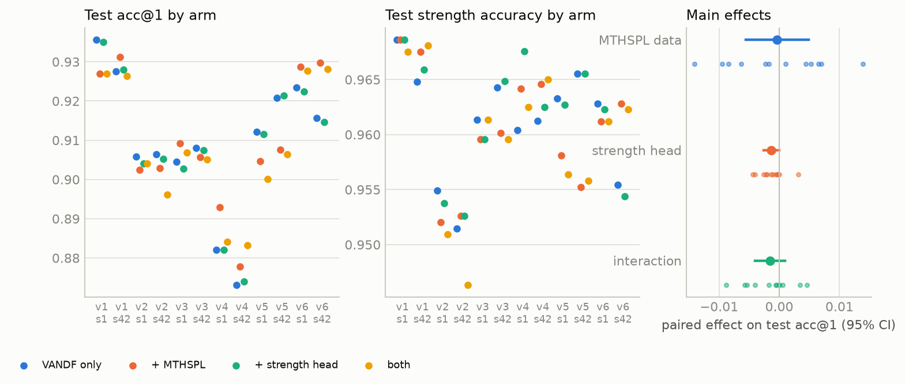
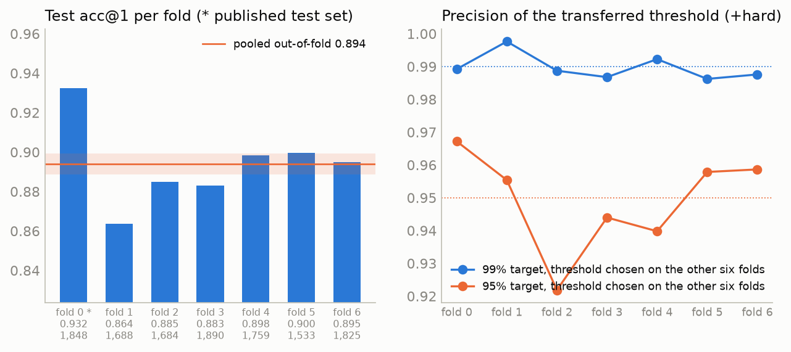

# Do More Names or a Strength Task Improve the VA Drug-Name Mapper?

*Three changes to the model from Part I, each tested on the same six divisions of the data and judged against the two-point spread that the choice of test drugs alone produces.*


In [Part I](https://withinnoise.dev/blog/posts/vandf-rxnorm-biencoder/) I trained a small model that matches drug names from the VA National Drug File, such as `PAROXETINE HCL 40MG TAB`, to the complete-product entries of RxNorm, the national drug vocabulary, such as `paroxetine hydrochloride 40 MG Oral Tablet`. On drugs whose ingredients it had never seen in training, it picked the correct product about 91% of the time, and that figure moved by about two points depending only on which drugs were set aside for testing.

Part I ended with a list of changes I expected to improve the model. This post tests three of them: adding drug names from a second source, training the model to predict each drug's strength as a side task, and measuring accuracy by cross-validation over all ingredients. Because the choice of test drugs alone moves accuracy by two points, a change tested on one division of the data could appear to help or harm by chance. So I tested each change on the same six divisions, trained it twice on each with a different random seed (the setting that decides the order of the training examples and other random choices), and credited it only if the twelve comparisons agreed.

## What I found

1. **Names from a second source did not help with VA names, but did help with names from that source.** The FDA's drug-label names are also linked to RxNorm, and are written in a longer style. Adding about 30,000 of them to the 9,300 VA training names changed accuracy on VA names by −0.03 points on average, positive in 6 of the 12 comparisons. Accuracy on held-out FDA names rose from 71% to 83%, in all 12.
2. **Training the model to predict strength did not improve its strength accuracy.** Wrong strength was the most common error of every model in Part I. With the side task, strength accuracy did not change, and overall accuracy fell by 0.1 to 0.2 points; it was higher with the task in at most one of the 12 comparisons.
3. **Cross-validation puts accuracy on unseen ingredients at 89.4%, inside Part I's range.** Every VA name was tested once by a model that had not seen its ingredients, 12,227 names in all, and Part I's published test set was again the most favourable group (93.2%). A model trained on every ingredient should be expected to reach about 89.4% on new drugs, not the 93.1% reported in Part I.
4. **The cut-off for automatic acceptance holds when it is chosen on enough data.** In Part I, a cut-off meant to accept only answers that are 99% correct achieved 98.2%. Chosen on six of seven groups and applied to the seventh, it achieved between 98.6% and 99.8%, 99.0% on average, while accepting about half of the names. A cut-off meant for 95% was less consistent, between 92.2% and 96.7%.
5. **The random seed matters more than Part I estimated.** The seed alone moves accuracy with a standard deviation of 0.45 points, not the 0.1 points that Part I estimated from three runs. The choice of test drugs still has about four times that effect.

In practice, Part I's recipe stays as it is for VA names. The experiment could detect a change of 0.2 points, which is the decrease the strength task caused, so the absence of an improvement means that neither change has an effect of the size I expected, not that the test was too coarse to find one.

## 1. What Part I left open

Part I's final recipe fine-tuned SapBERT ([Liu et al 2021](#references)), a biomedical language model, on pairs of VA names and RxNorm products. It scored 93.1% on the published test set. When I re-drew the division of ingredients into training and test five more times, the same recipe scored 90.7% on average, with a standard deviation of 1.9 points. Across a range of benchmarks, [Bouthillier et al 2021](#references) found that the choice of data split adds more variance than the choice of training seed, and the same held in Part I.

So a change that moves accuracy by one point on one division has shown nothing. Every version of the model here is trained on each of the same six divisions ("draws") at two seeds and compared within each draw-and-seed pair, and I report each effect with the number of the twelve pairs in which it was positive and a 95% interval.

The three changes:

- **A second source of names.** RxNorm links names from many sources to its own products, and each such link is a labelled training pair curated by the National Library of Medicine (NLM) ([Nelson et al 2011](#references)). I expected that four times as many training names, written in a different style, would help the model more than any change to its training objective.
- **A side task that predicts strength.** Strength was the largest error category of every model in Part I: three-quarters of the simplest baseline's errors, six in ten of the first trained model's, and the largest single share of the final model's 128. The model is never told what a strength is; it only learns that a name containing `250MG` tends to match a product containing `250 MG`. Training on a related side task, called multi-task learning ([Caruana 1997](#references)), suggests a remedy: attach a small classifier that must predict the correct product's strength from the model's reading of the VA name, train it with the main task, and discard it afterwards.
- **Cross-validation by ingredient, and a model trained on everything.** The published model was trained on 70% of ingredients, with 15% held out for choosing settings and 15% for testing. A model in use has no reason to leave any out. Cross-validation divides the ingredients into groups ("folds"), trains one model with each group held out, and pools the held-out scores into one estimate over about 12,000 names. The held-out predictions also show whether a cut-off chosen on some folds holds on another.

## 2. A second set of drug names

The UMLS licence gives each RxNorm source a restriction category. Category 0 adds no restrictions to the general licence terms, categories 1 to 4 add restrictions, and SNOMED CT has its own terms ([NLM 2026a](#references); [NLM 2026b](#references)). I used only category-0 sources, so that the published dataset and model carry no source-specific restrictions. That rules out the commercial drug databases and SNOMED CT, and leaves one large source: MTHSPL, the drug-product names from the FDA's Structured Product Labeling ([FDA 2026](#references)), which NLM brings into RxNorm ([NLM 2026a](#references)). Exactly one of its 49,036 names is the same as a VA name when case is ignored. The comparison is therefore VA names alone against VA names plus FDA names (called SPL strings in the figures and the Details). Details A lists every source.

The two styles differ a great deal. A VA name is short and abbreviated (median 34 characters). An FDA name is long, spelled out, and ends with the brand in brackets (median 66 characters):

| FDA label name | RxNorm product |
|---|---|
| `PAROXETINE HYDROCHLORIDE 40 mg ORAL TABLET, FILM COATED [Paroxetine]` | `paroxetine hydrochloride 40 MG Oral Tablet` |
| `CAMPHOR (SYNTHETIC) 35 mg in 1 g / MENTHOL 60 mg in 1 g TOPICAL PATCH [Arcticzen]` | `camphor 0.035 MG/MG / menthol 0.06 MG/MG Medicated Patch [Arcticzen]` |

The FDA names fall into the existing divisions without any new rule, because each product is assigned to training or test by its ingredients and every name follows its product. Each VA test set is therefore identical with or without the FDA names. On the published draw they add 29,505 training names to the VA's 9,290.

I kept two parts of the preprocessing at their VA settings, so that "more names" would not be mixed with "a different preprocessor". The length limit cuts off the bracketed brand on the longest one to two percent of FDA names, and Part I's rule that rewrites strengths in RxNorm's style does not understand the FDA's `35 mg in 1 g` notation.

## 3. What I decided in advance

With twelve comparisons and several measures, some effect will look real by chance unless the tests are fixed first. I wrote down five predictions and committed them to the project's public repository on 14 September 2026, before any of the 48 runs of the main grid had started ([the predictions at that commit](https://github.com/kvenanzi/rxnorm/blob/7adcd23/docs/post-2/README.md#2-hypotheses)). The pilot described in section 5, whose result was still blank at that commit, then chose one setting, the weight on the strength task, and nothing else.

| Question | What would count as yes | Result |
|---|---|---|
| 1a. Do FDA names raise accuracy on VA names? | A gain of about one point, of the same sign in the twelve comparisons | **No.** −0.03 points (95% interval −0.6 to +0.5), positive in 6 of 12. |
| 1b. Do FDA names raise accuracy on held-out FDA names? | A large gain | **Yes.** +12.3 points (+10.0 to +14.6), 12 of 12. |
| 2. Does the strength task reduce strength errors, leaving ingredient and dose form unchanged? | Fewer strength errors; a small effect on overall accuracy | **No.** Strength accuracy −0.01 points (5 of 12); overall accuracy −0.13 points on test (1 of 12) and −0.20 on validation (0 of 12). |
| 3. Do the two changes add up without interacting? | An interaction indistinguishable from zero | **Yes, but the test says little.** −0.15 points (−0.4 to +0.1), 4 of 12; both main effects on VA names are close to zero. |
| 4. Does any gain come from the new names, not from more training steps or more rows? | A longer VA-only run gains less than the FDA arm; a smaller FDA set keeps most of the gain | **Yes for FDA names; could not be tested on VA names,** where there was no gain to explain. On FDA names the smaller set kept all of the gain and the longer run lowered accuracy. |
| 5. Does cross-validation agree with Part I, and does a 99% cut-off hold? | Pooled accuracy within 90.7 ± 1.9%; a 99% cut-off chosen on six folds reaches at least 98% on the seventh | **Yes.** 89.4% (88.9 to 89.9); 98.6% to 99.8%. |

## 4. More names from FDA labels

The two training changes were run as one grid: with or without the FDA names, and with or without the strength task, on each of the six draws at two seeds, 48 runs in all. "Acc@1" below is the share of names for which the model's first answer is the correct product.



*Figure 1. Test acc@1 (left) and test strength accuracy (centre) for the four arms on each (draw, seed) unit, and the three paired effects on test acc@1 with their 95% intervals (right; the small markers are the twelve per-unit values). Data: `figures/data.json`; runs in sweeps `nypttmi8`, `ad9nakej`, `2v3am5xr`, `94onbtb5`, and `zcsece1l`.*

<!-- qmd
::: {.column-page-right}
```{=html}
<iframe src="figures/levers_cells.html" title="Every cell of the grid, by arm and unit"
        loading="lazy" style="border:none;width:100%;height:520px"></iframe>
```
:::
-->

The interactive chart [`figures/levers_cells.html`](figures/levers_cells.html) shows the same 48 cells with a menu that switches between VA test acc@1, test strength accuracy, acc@1 on the held-out SPL strings, validation acc@1, and test recall@5; hovering over a point gives its run and the epoch selected on validation.

**On VA names, the FDA names made no difference on average.** The average change was −0.03 points, and its 95% interval, −0.6 to +0.5 points, excludes the one-point gain I predicted. On single draws the extra names moved VA accuracy by up to one point in either direction, from −1.0 point on draw v5 to +1.0 on v6, and these shifts averaged to zero.

**On FDA names, they made a large difference.** The VA-only model maps held-out FDA names with 70.9% accuracy, 78% of its accuracy on VA names. Training on FDA names raised that to 83.3%, by 12.3 points, in all twelve comparisons, and raised strength accuracy on FDA names from 84.0% to 91.9%.

**Two control runs show where that gain comes from.** The FDA arm has four times as many training rows, so it also takes about four times as many training steps. I ran two controls once each on the most and least favourable draws (v1 and v4):

- **A steps control**, training on VA names for sixteen passes instead of four, about the FDA arm's number of steps. It *lowered* accuracy on FDA names, from 66.4% to 62.0% on v1 and from 66.7% to 61.1% on v4.
- **A size control**, adding only 9,300 FDA names, as many as there are VA names. It kept the whole gain: 83.8% against 84.3% with all the FDA names on v1, and 78.1% against 77.6% on v4.

So the gain comes from the FDA names themselves, not from longer training or more rows, and on these two draws 9,300 of them were enough. Training longer on one naming style made the model worse at the other. On VA names the controls have nothing to explain; their differences on v4 are of the same order as the difference between two seeds on that draw.

The model trained on FDA names is still less accurate on them than on VA names (83.3% against 91.0%), although FDA names make up about three-quarters of its training rows. The two preprocessing settings I held fixed are possible causes, and the remaining strength gap on FDA names, 91.9% against 96.1% on VA names, is consistent with the strength rule not reading the FDA's notation.

## 5. Teaching the model to predict strength

The strength task is one extra layer that reads the model's representation of a VA name and picks the correct product's strength from a list of 232 strengths, those with at least five training examples. It is trained alongside the main task and thrown away afterwards, so the saved model is unchanged.

**The pilot.** How much weight the side task gets had no precedent. At the start of training its error is about fifty times the main task's, so a large weight turns predicting strength into the main objective. I tried four weights on the published draw. As the weight increased, validation accuracy fell steadily, from 88.0% at weight 0.01 to 85.0% at 0.5, against 88.2% with no side task, while strength accuracy did not change at any weight. I ran the grid at 0.01, the largest weight that was not already worse than no side task.

**The grid.** At 0.01 the side task left strength accuracy unchanged (−0.01 points, positive in 5 of 12) and lowered overall accuracy slightly: by 0.13 points on test, positive in 1 of 12, and by 0.20 points on validation, positive in none. Ingredient accuracy fell by 0.08 points, and dose-form accuracy did not change. A decrease of 0.2 points is a ninth of the spread between draws. It could still be measured because the two arms of each comparison share the seed and so see the same training examples in the same order.

**Together.** Combining the FDA names and the side task gave an interaction of −0.15 points, with an interval that includes zero. Because neither change helped on VA names, this says little about how they would combine if either had worked.

## 6. Cross-validation, and a model trained on every ingredient

I divided the ingredients into seven folds with the same hash as Part I, arranged so that fold 0 is exactly Part I's published test set. Each of seven models trained on five folds, chose its best epoch (a pass through the training data) on a sixth, and was tested on the seventh, so each trained on 71% of the ingredients, as the published model did. They used the VA-only recipe, without the side task, because neither change had clearly helped on validation.



*Figure 2. Test acc@1 of each fold model on its held-out fold, with the pooled out-of-fold estimate and its Wilson 95% interval (left; the numbers under each bar are the fold's test acc@1 and its number of test strings), and the precision achieved on each fold by thresholds chosen on the other six, at the 95% and 99% targets, on the +hard population (right). Data: `figures/data.json`; runs in W&B group `kfold-k7`.*

<!-- qmd
::: {.column-page-right}
```{=html}
<iframe src="figures/kfold_epochs.html" title="The seven fold models by epoch"
        loading="lazy" style="border:none;width:100%;height:460px"></iframe>
```
:::
-->

The interactive chart [`figures/kfold_epochs.html`](figures/kfold_epochs.html) plots each fold model's validation acc@1 and strength accuracy after each of its four epochs and, from its menu, its training loss. The validation column of the fold table in Details C comes from scoring the kept epoch again after training; for folds 3 and 6 that score differs by one string from the value logged during training.

**The pooled estimate agrees with Part I.** Over the 12,227 VA names tested out of fold, accuracy is 89.4% (95% interval 88.9% to 89.9%). The folds range from 86.4% to 93.2%, a standard deviation of 2.1 points, of which sampling alone explains 0.7, leaving 2.0 due to which ingredients are held out. Part I's six draws gave 90.7 ± 1.9%, with 1.8 points due to the draw. Both methods also find Part I's published test set the most favourable: fold 0 scored 93.2%, the highest of the seven, as 93.1% was the highest of Part I's six draws. About 15% of VA names are never tested this way: combination drugs whose ingredients fall in different folds.

**The model trained on every ingredient.** The fold models most often chose their first epoch, and the differences between epochs were small, so the final model trained for one epoch on all 14,369 VA names. It has no test set of its own. Its expected accuracy on new drugs is the 89.4% from cross-validation, to the extent that its differences from the fold models (more data, a different learning-rate schedule) do not change it.

The FDA names were held out from both the final model and Part I's model. On them, the final model was more accurate than Part I's, by 2.5 points on names whose ingredients both had trained on and by 3.1 points on names whose ingredients only the final model had seen. On VA names that both had trained on, it was less accurate (90.9% against 93.9%), as one epoch of training against four should produce. The shorter schedule fits the training names less closely without lowering accuracy on unseen names, which agrees with the steps control in section 4. I published the final model separately from Part I's, as [kvenanzi/vandf-rxnorm-biencoder-all](https://huggingface.co/kvenanzi/vandf-rxnorm-biencoder-all).

## 7. Does the automatic-acceptance cut-off hold?

The model gives a confidence score with each answer, and a cut-off on that score decides which answers are accepted without review. In Part I, I turned the raw score into a probability with a temperature and a Platt layer ([Guo et al 2017](#references)) fit on one validation set, and chose the cut-offs there. The 99% cut-off then achieved 98.2% on a test set that included real drugs with no matching product. I wanted to know whether that shortfall belongs to the task or to a small validation set.

The out-of-fold predictions answer this, because every name in them was scored by a model that had not seen its ingredients. I fit the probability layer on all of them and shipped it with the final model. Then, for each fold, I chose the cut-offs on the other six folds and applied them to it. When a setting is chosen because it scores well on some data, the error measured on that same data tends to be lower than the true error ([Varma & Simon 2006](#references)), so only these held-out numbers count as the test.

**At the 99% target, the cut-off held.** Chosen on six folds, it achieved between 98.6% and 99.8% on the seventh, 99.0% on average, while accepting between 46.8% and 53.7% of names. Chosen on about 11,000 names instead of Part I's one validation split (1,907 matched names and 413 real drugs with no match), the shortfall disappears on average and is at most 0.4 points on any fold. Part I's shortfall therefore fits the sampling error of a cut-off chosen on a small set. A cut-off chosen on a single fold of about 1,800 names and applied to another reached 99.0% on average over the 42 pairs of folds, but fell as low as 98.2%, the value Part I's single split gave.

**At the 95% target, it held less well.** Three of the seven folds fell below 95% (92.2%, 94.0%, and 94.4%), and a cut-off chosen on one fold and applied to another fell as low as 90.6%.

## 8. How much the random seed matters

Part I estimated the seed's effect from three runs on one draw, on a GTX 1070, and got a standard deviation of 0.1 points. Here every arm ran at two seeds on each of six draws on an A100, which gives 24 pairs that differ only in the seed, and they put it at 0.45 points. A standard deviation estimated from three values is uncertain by a factor of about 0.5 to 6, so the two estimates do not contradict each other. Runs repeated at the same seed agree to within 0.05 points, so the variation comes from the seed, not from the software.

The draw therefore contributes about four times the seed's standard deviation, not twenty as Part I had said. The draw still matters most, but a single run's accuracy can move by about ±0.9 points from the seed alone, which is the size of the per-draw shifts from the FDA names in section 4.

## 9. What could be wrong

- **Two seeds per draw.** The seed's effect enters every comparison between arms that see different training batches, including the FDA-name comparison. A third seed per draw would narrow that interval by about a fifth.
- **The controls are single runs**, on two draws. They support the explanation of the large gain on FDA names, but say nothing about VA names, where their differences are the size of the seed's effect.
- **One weight for the strength task.** Smaller weights than 0.01 are untested; the pilot's steady trend suggests they would come closer to no side task rather than improve on it.
- **The FDA arm's schedule.** The FDA arm chose its last epoch on 4 of the 12 units and the VA-only arm on none, so a longer schedule might change its validation result. The steps control trains on VA names only and does not answer this.
- **The final model is not the fold models.** It trained on every ingredient instead of 71%, and for one full epoch instead of stopping a quarter of the way through a four-epoch schedule. Cross-validation estimates tend to be pessimistic for a model trained on more data ([Kohavi 1995](#references)). Neither difference has been measured on new VA names.
- **Gaps in cross-validation.** 15% of VA names are never tested, and the folds are one partition at one seed. The interval on the pooled estimate reflects sampling only, not the seed's effect.
- **Few hard cases for the cut-off.** Each fold has 110 to 131 real drugs with no matching product, 819 in all, and the precision at each cut-off depends on them.
- **One kind of GPU.** All runs here used one Colab A100 configuration; Part I's seed estimate was made on a GTX 1070.

## 10. What I take from this

Neither change to training improved the matching of VA names. The FDA names helped only with FDA names, and the strength task did not improve strength. One possible reason, which neither experiment tests directly, is that part of the remaining error cannot be removed, because some VA names do not contain the information needed to pick the product, as Part I found when it examined the errors. Cross-validation confirmed Part I's range by a second method and showed that a 99% cut-off holds when it is chosen on enough data.

For anyone using the model:

- **For VA names**, use the recipe unchanged, or the model trained on every ingredient, [kvenanzi/vandf-rxnorm-biencoder-all](https://huggingface.co/kvenanzi/vandf-rxnorm-biencoder-all), with its expected accuracy of 89.4%.
- **For inputs that include FDA label names** or similar long names, training on FDA names as well raised accuracy on them by twelve points with no measurable effect on VA names, and 9,300 of them reached the full gain on the two draws tested.
- **For automatic acceptance**, a 99% cut-off fit on the cross-validation predictions achieved 98.6% to 99.8% on held-out ingredients while accepting about half the names. At 95%, choose the cut-off on your own data.

The next steps I would try:

1. **Teach the strength rule the FDA notation** (`X mg in 1 mL`, `X mg in 1 g`) and repeat the FDA arm, because of the strength gap in section 4.
2. **Use strength when ranking answers instead of during training**, for example by re-ranking the top candidates by whether their strength matches the strength read from the VA name. The null result here concerns the training signal only.
3. **Run a third seed per draw** for the FDA-name comparison.
4. **Test the combination drugs** whose ingredients span folds.

---

## Details for anyone who wants to check the work

### A. Data

- **Sources.** The September 2026 release carries thirteen sources. `RXNSAB` records each one's restriction category in its `SRL` column:

  | Source | Description | SRL | Active atoms linked to an SCD/SBD | Distinct strings | Targets covered |
  |---|---|---|---|---|---|
  | RXNORM | NLM's normalized names (the target side) | 0 | 91,762 | 78,903 | 27,287 |
  | **MTHSPL** | **FDA Structured Product Label names** | **0** | **101,005** | **49,036** | **16,000** |
  | NDDF | FDB MedKnowledge | 3 | 30,706 | 22,541 | 9,495 |
  | GS | Gold Standard | 3 | 22,593 | 21,186 | 12,927 |
  | MMSL | Multum | 1 | 22,048 | 22,048 | 15,016 |
  | MMX | Micromedex | 3 | 20,645 | 20,620 | 14,734 |
  | VANDF | VA National Drug File (the query side) | 0 | 17,964 | 14,931 | 8,315 |
  | SNOMEDCT_US | SNOMED CT | 9 | 14,036 | 14,036 | 6,219 |
  | CVX | vaccine codes | 0 | 187 | 187 | 181 |
  | MTHCMSFRF | CMS formulary reference | 0 | 3 | 3 | 3 |
  | ATC, DRUGBANK, USP | classifications and monographs | 0 | 0 | 0 | 0 |

  MTHSPL is the largest source in the table. NDDF, GS, MMSL, and MMX are larger than the VA file but are category 1 or 3, and using them would make the published dataset card's statement that no restricted content was used untrue.
- **FDA string lengths.** 99th percentile 240 characters, against a 96-token limit chosen for the VA. Extending the strength rule to the `35 mg in 1 g` form would take a two-line addition to its regular expression.
- **Pairing.** `DP` (drug product) atoms only, with NLM's generated `MTH_RXN_DP` duplicates excluded, as `MTH_RXN_CD` was for the VA. After removing duplicate (string, target) pairs: 48,985 pairs over 47,635 distinct strings and 16,000 targets, plus 21,595 active SPL strings whose concept has no SCD/SBD; these join the unmatched set and are divided between validation and test by the same string hash.
- **Splitting.** The published split assigns every ingredient to train, validation, or test by an MD5 hash of its RXCUI; a target follows its ingredients, and query strings follow their target. The SPL strings add 30,218 to 33,681 training rows on the five draws other than the published one.
- **Strings whose targets span splits.** Eleven SPL strings across three draws (six in v3, four in v4, one in v5) map to two products whose ingredients were assigned to different splits, for example a label name that covers two products with different active ingredients, which NLM links to both. The VA never does this, because its names are written per product. Such a string can be neither trained on nor scored, so the loader drops them and reports the count. This changes no count in this post by a visible amount and affects no VA row.
- **Folds.** The published salt hashes each ingredient into a bucket from 0 to 99, with buckets 0–14 as test and 15–29 as validation. Fold = ⌊7 × bucket / 100⌋ makes fold 0 exactly buckets 0–14. Fold i is tested with fold i+1 as validation and the other five as training. A target whose ingredients span the three sets is excluded from that fold. The seven test sets hold 1,848, 1,688, 1,684, 1,890, 1,759, 1,533, and 1,825 VA strings: 12,227 of the 14,369 distinct VA strings, and 12,230 of the 14,372 pairs, since three strings in fold 6 each have two correct targets. The final model's data folder assigns every ingredient to train.

### B. Design and models

- **The recipe.** Part I's final recipe, unchanged: SapBERT fine-tuned with an in-batch contrastive loss, ingredient-matched hard negatives, and a rule that appends RxNorm-style concentrations to the VA string. The settings are explained in the project's [training primer](https://github.com/kvenanzi/rxnorm/blob/main/docs/training-primer.md).
- **The grid.** One W&B grid (`sweeps/levers.yaml`): {VA only, VA + MTHSPL} × {no head, strength head} × six draws × seeds 42 and 1, 48 runs on one Colab A100. Selection is on `val/acc@1`. The `val` and `test` keys stay VA-only, and the SPL strings of the same draw are scored under separate keys. Epochs are fixed at four for both data arms.
- **The controls.** On v1 and v4, seed 42: VA only for sixteen epochs (about the SPL arm's number of optimizer steps), and VA plus 9,300 SPL rows for four epochs (twice the VA arm's steps and about half the SPL arm's).
- **Analysis.** Paired within (draw, seed), twelve units. Each main effect is the mean of its two simple contrasts within a unit, and the interaction is the double difference; each has a sign count and a t interval over the twelve. Units that share training data are correlated, so such intervals are optimistic ([Nadeau & Bengio 2003](#references)), which is why the sign count is reported with them.
- **The strength head.** One linear layer on the query embedding, 768 inputs and one output per strength class, trained by cross-entropy against the strength string of the positive (`250 MG`, `0.025 MG/ML`, or the ` / `-joined list for a combination product). The 232 classes cover 79% of VA training rows (220 to 248 classes per draw in the VA-only arm of the grid). A 232-way cross-entropy begins near 4 nats; the contrastive loss is near 0.09 after warm-up and 0.03 at the end of training.
- **The folds.** Each fold trains the VA-only arm at seed 42, selects its epoch on its validation fold, scores its test fold once, and logs every string's top-20 candidates and cosine similarities. The pooled accuracy has a Wilson interval. The final model trains on the all-ingredient folder for the median best epoch of the seven, since it has no validation set to stop on.
- **Calibration.** Temperature and Platt parameters are fit on the pooled out-of-fold predictions for Part I's "+hard" population: matched strings plus hard unmatched ones (real drugs with no clinical-drug concept), each unmatched string assigned to one fold by a hash of its text. The fitted layer is the same four-number `calibration.json` the published model carries. Thresholds at 95% and 99% are chosen on six folds and applied to the seventh, and a seven-by-seven matrix of thresholds chosen on fold i and applied to fold j is also computed. The reading: if leave-one-fold-out precision matches the single-split result, the shortfall is a property of the task; if it varies across folds, a deployment should re-select thresholds on its own data.

### C. Full results

**Grid.** Test acc@1 per unit and arm, validation acc@1 in parentheses (`outputs/levers/levers.md`):

| draw | seed | VA only | + SPL | + head | + SPL + head | SPL − VA only | head − VA only |
|---|---|---|---|---|---|---|---|
| v1 | 42 | 0.927 (0.885) | 0.931 (0.875) | 0.928 (0.883) | 0.926 (0.869) | +0.004 | +0.001 |
| v1 | 1 | 0.936 (0.878) | 0.927 (0.882) | 0.935 (0.878) | 0.927 (0.882) | −0.009 | −0.001 |
| v2 | 42 | 0.906 (0.914) | 0.903 (0.916) | 0.905 (0.914) | 0.896 (0.913) | −0.003 | −0.001 |
| v2 | 1 | 0.906 (0.916) | 0.902 (0.924) | 0.904 (0.914) | 0.904 (0.923) | −0.003 | −0.002 |
| v3 | 42 | 0.908 (0.914) | 0.906 (0.921) | 0.907 (0.914) | 0.905 (0.919) | −0.002 | −0.001 |
| v3 | 1 | 0.905 (0.914) | 0.909 (0.924) | 0.903 (0.914) | 0.907 (0.919) | +0.005 | −0.002 |
| v4 | 42 | 0.873 (0.908) | 0.878 (0.904) | 0.874 (0.906) | 0.883 (0.901) | +0.005 | +0.001 |
| v4 | 1 | 0.882 (0.904) | 0.893 (0.899) | 0.882 (0.903) | 0.884 (0.897) | +0.011 | +0.000 |
| v5 | 42 | 0.921 (0.903) | 0.908 (0.901) | 0.921 (0.899) | 0.906 (0.902) | −0.013 | +0.001 |
| v5 | 1 | 0.912 (0.897) | 0.905 (0.902) | 0.912 (0.896) | 0.900 (0.897) | −0.007 | −0.001 |
| v6 | 42 | 0.916 (0.878) | 0.930 (0.885) | 0.915 (0.878) | 0.928 (0.883) | +0.014 | −0.001 |
| v6 | 1 | 0.923 (0.885) | 0.929 (0.898) | 0.922 (0.883) | 0.928 (0.891) | +0.005 | −0.001 |
| **mean ± sd** | | 0.910 ± 0.018 (0.900) | 0.910 ± 0.016 (0.902) | 0.909 ± 0.018 (0.898) | 0.908 ± 0.016 (0.900) | | |

**Paired effects**, t intervals over the twelve units:

| effect | metric | mean | 95% CI | units positive |
|---|---|---|---|---|
| SPL strings | VA test acc@1 | −0.0003 | −0.006 to +0.005 | 6 / 12 |
| | VA val acc@1 | +0.0020 | −0.002 to +0.006 | 9 / 12 |
| | VA test recall@5 | +0.0017 | −0.001 to +0.005 | 8 / 12 |
| | VA test strength accuracy | −0.0013 | −0.004 to +0.002 | 3 / 12 |
| | SPL test acc@1 | **+0.1230** | +0.100 to +0.146 | 12 / 12 |
| strength head | VA test acc@1 | −0.0013 | −0.003 to 0.000 | 1 / 12 |
| | VA val acc@1 | −0.0020 | −0.003 to −0.001 | 0 / 12 |
| | VA test strength accuracy | −0.0001 | −0.001 to +0.001 | 5 / 12 |
| | VA test ingredient accuracy | −0.0008 | −0.002 to 0.000 | 3 / 12 |
| | VA test dose-form accuracy | −0.0001 | −0.001 to +0.001 | 6 / 12 |
| | SPL test acc@1 | +0.0006 | −0.004 to +0.005 | 5 / 12 |
| interaction | VA test acc@1 | −0.0015 | −0.004 to +0.001 | 4 / 12 |
| | VA val acc@1 | −0.0017 | −0.003 to 0.000 | 2 / 12 |

- **SPL strings on VA names.** The per-unit contrast has a standard deviation of 0.0082, larger than the 0.0064 that seed variation would produce for a difference of two runs. Its sign agrees between the two seeds on four of the six draws; its mean per draw ranges from −0.010 (v5) to +0.010 (v6).
- **The strength head.** On test, the interval's upper end is −0.00002; on validation, t = −5.7. The 0.0020 decrease on validation is a ninth of the split standard deviation (0.018) and less than half the seed standard deviation (0.0043). Sharing the seed and batches reduces the standard deviation of the paired contrast to 0.0012 on validation.
- **Seed variation.** From the 24 same-draw pairs, the pooled standard deviation of a single run's test acc@1 is 0.0045 (validation 0.0043). The between-draw standard deviation of the VA-only arm, corrected for the seed variation left in a two-seed mean, is 0.018, against Part I's 0.019. The three v6 cells that ran twice at the same seed agree to within 0.0005 on test and 0.0012 on validation.
- **SPL transfer.** 5,132 to 7,807 held-out SPL strings per draw. SPL test acc@1 0.709 ± 0.057 (VA-only) and 0.833 ± 0.036 (SPL arm) over the twelve units; SPL validation acc@1 0.733 and 0.841; SPL strength accuracy 0.840 and 0.919 (+0.076, 12 of 12).

**Pilot** (published draw, seed 42, VA strings only, GTX 1070; the reference is Part I's split-v1 run on the same GPU). Runs were done in the order 0.2, 0.5, 0.05, 0.01; the last two were added after the first two showed the direction of the effect.

| head weight | run | val acc@1 by epoch | best val acc@1 | test acc@1 | strength | ingredient | dose form |
|---|---|---|---|---|---|---|---|
| none | `lqf7dett` | – | 0.882 | 0.931 | 0.961 | 0.983 | 0.972 |
| 0.01 | `tiotc7iy` | 0.877 → 0.876 → **0.880** → 0.880 | 0.880 | 0.928 | 0.963 | 0.985 | 0.970 |
| 0.05 | `9zw6jvov` | **0.874** → 0.870 → 0.872 → 0.872 | 0.874 | 0.923 | 0.962 | 0.983 | 0.969 |
| 0.2 | `0usjnp44` | 0.859 → **0.864** → 0.850 → 0.848 | 0.864 | 0.904 | 0.963 | 0.975 | 0.964 |
| 0.5 | `spja8f8i` | **0.849** → 0.842 → 0.821 → 0.811 | 0.850 | 0.890 | 0.957 | 0.973 | 0.956 |

**Controls**, one run each at seed 42, against the matching grid cells. On v4 the steps and size controls exceed the VA-only arm by 0.018 and 0.023 on VA test, with validation unchanged; the grid's two seeds of the SPL arm differ by 0.015 on v4 test. The size control used about 30% of the available SPL rows.

| run | training rows per epoch (× VA arm) | epochs | v1 VA test | v1 VA val | v1 SPL test | v4 VA test | v4 VA val | v4 SPL test |
|---|---|---|---|---|---|---|---|---|
| VA only | 1 | 4 | 0.927 | 0.885 | 0.664 | 0.873 | 0.908 | 0.667 |
| VA + all SPL | 4.2 | 4 | 0.931 | 0.875 | 0.843 | 0.878 | 0.904 | 0.776 |
| VA only, sixteen epochs (steps control) | 1 | 16 | 0.932 | 0.886 | 0.620 | 0.891 | 0.907 | 0.611 |
| VA + 9,300 SPL (size control) | 2 | 4 | 0.927 | 0.877 | 0.838 | 0.896 | 0.906 | 0.781 |

**Folds** (`outputs/kfold/oof.md`):

| fold | test n | best epoch | val acc@1 | test acc@1 | test recall@5 | strength | dose form | ingredient |
|---|---|---|---|---|---|---|---|---|
| 0 (published test set) | 1,848 | 1 | 0.870 | 0.932 | 0.988 | 0.966 | 0.972 | 0.986 |
| 1 | 1,688 | 1 | 0.898 | 0.864 | 0.967 | 0.925 | 0.958 | 0.966 |
| 2 | 1,684 | 3 | 0.887 | 0.885 | 0.983 | 0.970 | 0.951 | 0.986 |
| 3 | 1,890 | 3 | 0.908 | 0.883 | 0.980 | 0.966 | 0.967 | 0.975 |
| 4 | 1,759 | 1 | 0.895 | 0.898 | 0.960 | 0.947 | 0.977 | 0.992 |
| 5 | 1,533 | 3 | 0.902 | 0.900 | 0.967 | 0.932 | 0.967 | 0.983 |
| 6 | 1,825 | 1 | 0.937 | 0.895 | 0.975 | 0.960 | 0.970 | 0.983 |
| **pooled out-of-fold** | **12,227** | | | **0.894** | 0.975 | | | |

- **Pooled.** 10,932 of 12,227 correct, Wilson 95% 0.889–0.899. The test folds cover 85.1% of the 14,369 distinct VA strings.
- **Spread.** Across folds 0.894 ± 0.021, range 0.864–0.932; binomial sampling accounts for 0.007 of that standard deviation. Part I's six draws used six different hashes, not seven ranges of one hash. The published test set is 3.8 points above the fold mean here, and was 2.4 points above the six-draw mean in Part I. The pooled estimate is 0.013 below the six-draw mean.
- **Fold 0** trains on nearly the published training set (bucket 29 moves from validation to training) and scores 0.932 on the published test set, against the published 0.931. Its validation accuracy was 0.870 at the first epoch and 0.864–0.866 at the later three.

**Final model against Part I's model** (run `qwn31tzn`; `outputs/kfold/compare.md`):

- On the 28,464 SPL strings whose ingredients were in the published draw's training split: 0.753 against 0.729 (+0.025). 1,409 strings are answered correctly by the final model alone and 701 by Part I's model alone (exact sign test, p ≈ 2 × 10⁻⁵⁴).
- On the 13,492 SPL strings whose ingredients only the final model trained on: 0.746 against 0.716 (+0.031).
- On the 9,287 VA strings on which both trained: 0.909 against 0.939.

**Calibration** (`outputs/kfold/calibration.md`). The +hard pool has 13,046 strings: 12,227 matched and 819 hard unmatched, 110 to 131 of the latter per fold. Fitted temperature 0.0386 (Part I: 0.042). On the pooled predictions, AUROC for a correct first answer is 0.928 for the Platt score, 0.911 for the softmax, and 0.888 for the raw cosine, and the Platt layer's expected calibration error is 0.014. The pooled columns below are fit and evaluated on the same predictions and are shown only for completeness. Part I's 0.982 at the 99% target was on the +hard test population at 46.0% coverage.

| target | pooled threshold | pooled coverage | pooled precision | precision, threshold from the other six folds: mean ± sd (range) | coverage, same | precision, threshold from one fold applied to another: mean (minimum) |
|---|---|---|---|---|---|---|
| 95% | 0.735 | 0.806 | 0.950 | 0.949 ± 0.015 (0.922–0.967) | 0.805 ± 0.026 | 0.947 (0.906) |
| 99% | 0.961 | 0.494 | 0.990 | 0.990 ± 0.004 (0.986–0.998) | 0.496 ± 0.027 | 0.990 (0.982) |

### D. Decisions

| Decision | Reason |
|---|---|
| `val/*` and `test/*` remain VA-only | Every published panel, table, and script reads those keys |
| Epochs fixed at four; a sixteen-epoch control instead | "Same recipe, more data" is the deployment question; the control separates steps from strings |
| The head is a parameter of the loss module, not the model | The trainer optimizes it, `model.save()` never writes it, and inference is unchanged |
| The head's initialization seeded separately from the training stream | The two arms of a seed then see identical batches |
| Rare strengths get no head loss rather than an OTHER class | A class holding a fifth of the rows would train the head toward an uninformative cluster |
| Head weight chosen by a pilot on the published split, on validation | The weight has no precedent here and the pilot showed it to be decisive; the published split has a reference run on the same GPU |
| Seven folds, contiguous buckets | 71/14/14 as in the published split, and fold 0 reproduces the published test set |
| Unmatched strings assigned to one fold by hash | They are never trained on, so any fold's model scores them out of fold; the hash counts each once |
| Calibration fit on the pooled out-of-fold predictions | The all-data model has no held-out strings; the fold models' held-out predictions are the closest unbiased substitute |
| Only the all-data model keeps its weights | 48 grid checkpoints would take about 21 GB with no use in the analysis |
| A separate artifact name for the all-data model | `vandf-rxnorm-biencoder:latest` must keep pointing at the published model |
| Failed grid cells re-run in make-up sweeps rather than a fresh grid | A finished cell re-run on the same GPU type lands within about 0.001 acc@1 of itself, so a fresh grid would add only noise of that size |
| The folds train the VA-only arm, without the head (chosen by this rule before any fold ran) | Selection is on validation accuracy, and an effect is credited only when its interval excludes zero. The head lowered validation accuracy on all twelve units; the SPL arm's simple contrast against the VA-only arm was +0.0028 on validation (−0.001 to +0.007, 8 of 12). The VA-only arm is also the recipe that prediction 5 is stated for, and it trains in about a quarter of the SPL arm's time |
| The all-data model is published in its own repository | Part I and its model card describe the model they measured, at 0.931 on the published test set; the all-data model has no test set of its own |

### E. Reproduction

- **Code:** the same repository as Part I, [github.com/kvenanzi/rxnorm](https://github.com/kvenanzi/rxnorm); the commands are in its README under "The follow-up". Nothing Part I depends on has changed, and the default dataset build emits byte-identical SQL. Every new behaviour is behind a new flag or configuration field with a default. Nineteen unit tests cover the new code, including one that the default build's SQL is byte-identical and one that the head loss's contrastive term equals the library's to floating-point precision.
- **Model:** [kvenanzi/vandf-rxnorm-biencoder-all](https://huggingface.co/kvenanzi/vandf-rxnorm-biencoder-all), with `calibration.json`.
- **Runs:** sweeps `nypttmi8` (the grid), `ad9nakej`, `2v3am5xr`, `94onbtb5`, and `zcsece1l` (make-up cells), `2exoct4h` and `ocmpf5na` (the controls); W&B group `kfold-k7` for the folds (`eiaktu3s`, `jobvjf5p`, `5btdesbn`, `aefstan3`, `70v08ec3`, `xkk4lioe`, `3ppkzzgb`) and the all-data model (`qwn31tzn`); group `levers-pilot` for the pilot.
- **Run records:** [`figures/runs.json`](figures/runs.json) lists the 89 runs of this post with their configuration and final metrics: the pilot, the grid and its re-runs, the controls, the folds, and the all-data model. They were tracked in Weights & Biases (project `within-noise/rxnorm-vandf`) and exported from it on 4 November 2026.
- **Artifacts:** stored in Weights & Biases and no longer public, except the all-data model: `vandf-rxnorm-multi:v0` (the six draws with both sources), `vandf-rxnorm-kfold:v0` (the folds), `vandf-rxnorm-predictions` per fold, and `vandf-rxnorm-biencoder-final-all` (`v0` the weights as trained, `v1` with `calibration.json`). The published artifacts `vandf-rxnorm-pairs`, `vandf-rxnorm-splits`, and `vandf-rxnorm-biencoder` are unchanged.
- **Outputs:** `outputs/levers/levers.md` (`13_levers.py summarize`, which merges the five grid sweeps and the two controls); `outputs/kfold/oof.md`, `calibration.md`, and `compare.md` (`14_kfold.py oof`, `calibrate-oof`, and `compare`); the two figures (`11_figures.py --only levers --only kfold`).
- **Compute:** 5.2 hours of A100 run time, excluding runtime start-up: 4.4 hours for the grid (2.4 minutes per VA-only run and 7.9 per SPL run, including 6 minutes in the runs that failed), 22 minutes for the four control runs, and 25 minutes for the seven folds and the all-data model (3.2 and 2.3 minutes per run). The pilot and the comparison with Part I's model ran on a GTX 1070.

**What failed, and what was re-run.**

- **First grid session** (14 September 2026, A100). The v1 VA-only cell reproduced the matching Part I sweep cell to four decimals (0.927). Twelve cells on v3, v4, and v5 then failed at load time: the loader had been written to *reject* the eleven spanning strings rather than drop them, and the three draws containing any were the three that failed. Three strength-head cells (VA-only arm, v1 seed 42, v1 seed 1, and v2 seed 42) failed on an import of a sentence-transformers internal that Colab's version of the library lacks; the loss now uses only the public model call. The sweep agent was stopped by hand after each, which ended the paired SPL cell during its retrieval step, and once more during the v6 seed-42 SPL cell.
- **Make-up sweeps.** A grid sweep does not re-issue a failed cell, so the nineteen were re-issued: `ad9nakej` for the thirteen cells without the head (three finished v6 cells ran again with them, which gives the same-seed reproducibility figure), `2v3am5xr` for the v1 seed-42 head pair, and `94onbtb5` and `zcsece1l` for the v1 seed-1 and v2 seed-42 head pairs, which an audit of the merged grid on 15 September found had been left out. The analysis takes the most recently finished run per cell.
- **Second grid session** (15 September 2026, A100). The make-up sweeps and both controls completed; the merged grid holds 48 of 48 cells.
- **Folds** (15 September 2026, A100). A test run on the GTX 1070 found that the fold script passed the epoch count to the trainer twice, which would have stopped every fold at its start; it was fixed, with a test, before the A100 session. The seven folds and the all-data model then ran in one session of about thirty minutes. The all-data model was trained before the out-of-fold calibration existed, so its artifact was logged again as `v1` with `calibration.json` (`14_kfold.py attach-calibration`); loaded from `v1`, the model maps VA strings end to end with the calibrated threshold.
- **Final model check** (15 September 2026, GTX 1070). The all-data model and Part I's model were scored on the SPL strings of the published draw; the all-data model was the more accurate, and was published in a Hugging Face repository of its own.

## How this was made

I chose the question, set the rules, and edited the text. Claude Code wrote the code, ran the analysis, found the references, and drafted the post.

Claude checked each citation against its source: against the full text where an open copy existed, and against the abstract for Caruana 1997 and Nadeau & Bengio 2003 (for the second, also the full text of its 1999 conference version).

## References

**Drug vocabularies and licensing**

- FDA (2026). "Structured Product Labeling Resources". [fda.gov/…/structured-product-labeling-resources](https://www.fda.gov/industry/fda-data-standards-advisory-board/structured-product-labeling-resources)
- Nelson SJ, Zeng K, Kilbourne J, Powell T, Moore R (2011). "Normalized names for clinical drugs: RxNorm at 6 years". *Journal of the American Medical Informatics Association* 18(4):441–448. [doi:10.1136/amiajnl-2011-000116](https://doi.org/10.1136/amiajnl-2011-000116)
- NLM (2026a). "RxNorm Technical Documentation". [nlm.nih.gov/research/umls/rxnorm/docs/techdoc.html](https://www.nlm.nih.gov/research/umls/rxnorm/docs/techdoc.html)
- NLM (2026b). "UMLS Metathesaurus License Agreement Appendix". [nlm.nih.gov/…/license_agreement_appendix.html](https://www.nlm.nih.gov/research/umls/knowledge_sources/metathesaurus/release/license_agreement_appendix.html)

**The model and the side task**

- Caruana R (1997). "Multitask Learning". *Machine Learning* 28(1):41–75. [doi:10.1023/A:1007379606734](https://doi.org/10.1023/A:1007379606734)
- Liu F, Shareghi E, Meng Z, Basaldella M, Collier N (2021). "Self-Alignment Pretraining for Biomedical Entity Representations". *Proceedings of NAACL-HLT 2021*:4228–4238. [aclanthology.org/2021.naacl-main.334](https://aclanthology.org/2021.naacl-main.334/)

**Comparing models and estimating accuracy**

- Bouthillier X, Delaunay P, Bronzi M, Trofimov A, Nichyporuk B, Szeto J, Sepah N, Raff E, Madan K, Voleti V, Kahou SE, Michalski V, Serdyuk D, Arbel T, Pal C, Varoquaux G, Vincent P (2021). "Accounting for Variance in Machine Learning Benchmarks". *Proceedings of Machine Learning and Systems* 3. [arXiv:2103.03098](https://arxiv.org/abs/2103.03098)
- Kohavi R (1995). "A Study of Cross-Validation and Bootstrap for Accuracy Estimation and Model Selection". *Proceedings of IJCAI 1995*:1137–1143.
- Nadeau C, Bengio Y (2003). "Inference for the Generalization Error". *Machine Learning* 52:239–281. [doi:10.1023/A:1024068626366](https://doi.org/10.1023/A:1024068626366)
- Varma S, Simon R (2006). "Bias in error estimation when using cross-validation for model selection". *BMC Bioinformatics* 7:91. [doi:10.1186/1471-2105-7-91](https://doi.org/10.1186/1471-2105-7-91)

**Calibration**

- Guo C, Pleiss G, Sun Y, Weinberger KQ (2017). "On Calibration of Modern Neural Networks". *Proceedings of ICML 2017*. [arXiv:1706.04599](https://arxiv.org/abs/1706.04599)
