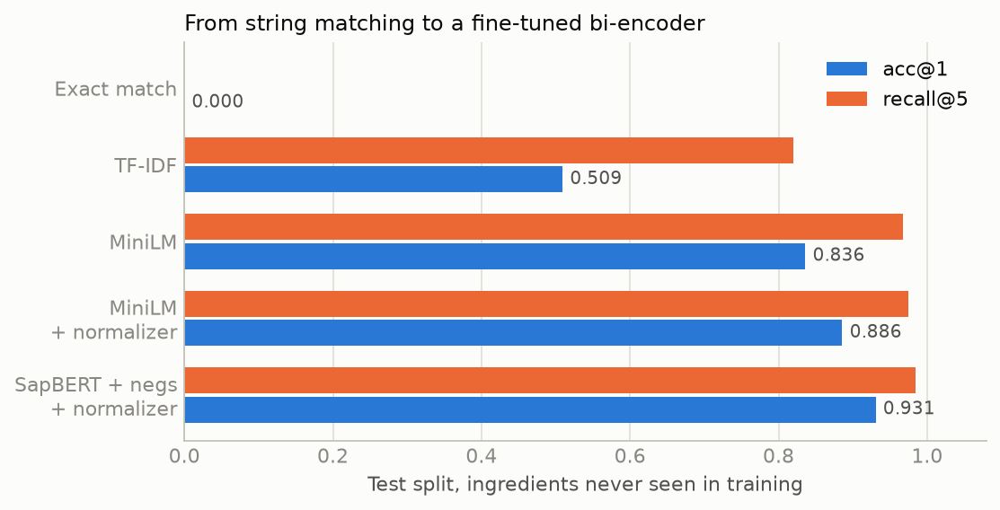
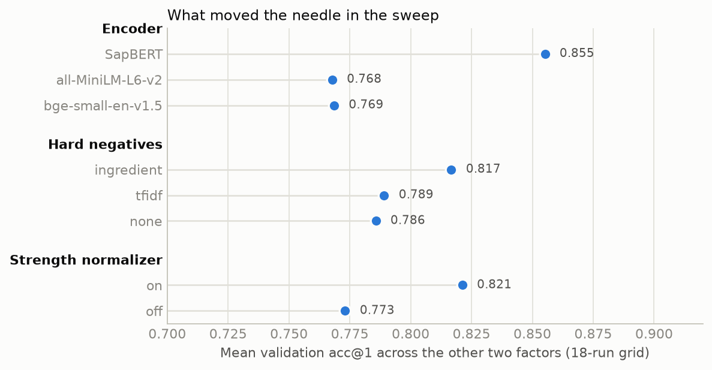
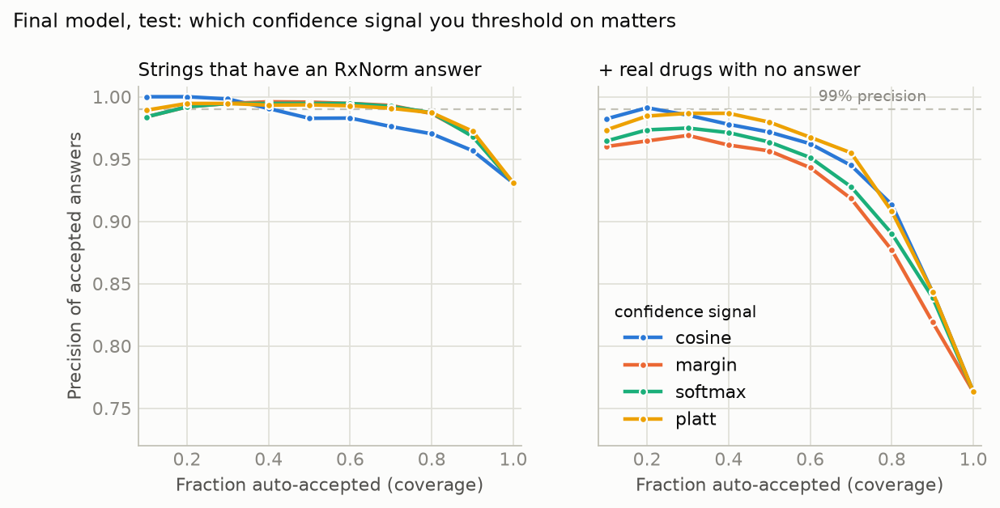
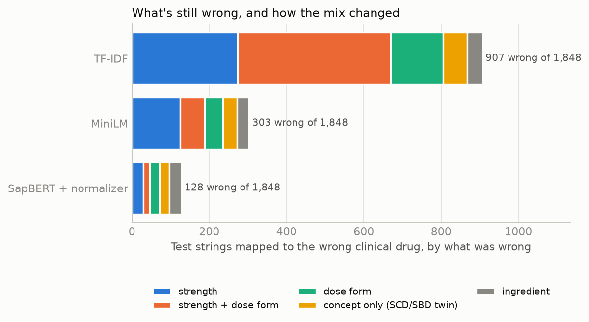
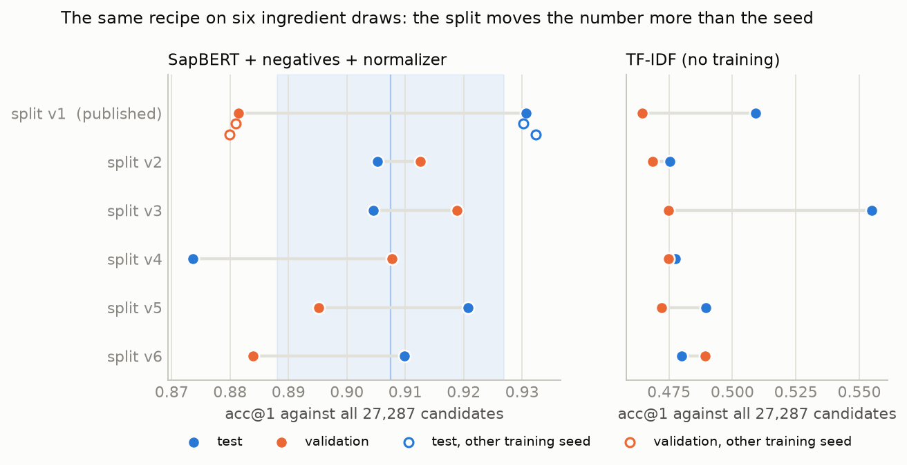
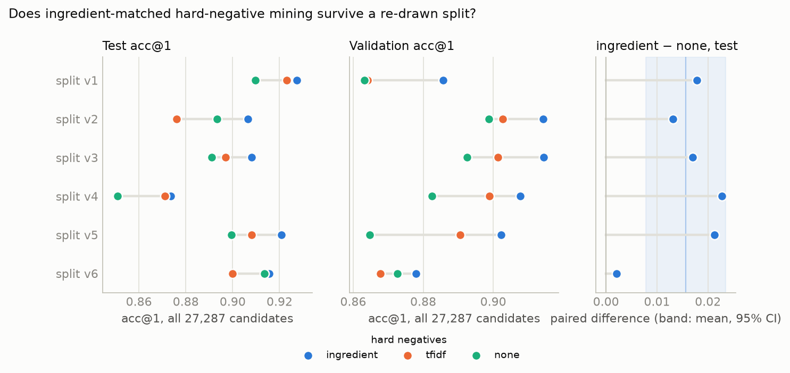

# Can a Small Model Match VA Drug Names to the Exact RxNorm Product?

*Training a retrieval model on the links between VA drug names and RxNorm that the National Library of Medicine already maintains, and testing it on drugs whose ingredients it has never seen. Part I of two.*

*Kevin Venanzi · first published 11 September 2026 · rewritten 6 November 2026*

The problem I started from is this. A VA pharmacy records a drug under the VA's own name, such as `PAROXETINE HCL 40MG TAB`, while most other health systems and drug-interaction software use RxNorm, the National Library of Medicine's drug vocabulary, where the same product is `paroxetine hydrochloride 40 MG Oral Tablet`. Published tools already match names like these reliably to the active ingredient. A pharmacy needs the ingredient, the strength, and the form (tablet, solution, patch) together, which RxNorm calls a *clinical drug*.

I wanted to know how accurately a small machine-learning model could make that complete match, using only public data, and I could not find a published trained model for it. The training labels cost nothing, because the Library's staff link VA names to RxNorm entries and publish the links. This was also my first project that trained a model and tracked the runs, which is one reason the testing rules below are described in detail.

## What I found

1. **Comparing the text directly does not work.** Not one of the 14,372 VA names is identical to its RxNorm name, even with capitals and punctuation ignored. A standard method that scores names by the letter fragments they share finds the right ingredient 98% of the time but the right complete product only 51% of the time.
2. **A model trained on the linked pairs finds the right product in most cases.** The first version chose the right product for 84% of drugs whose ingredients it had never seen. The final version chose it 93.1% of the time on the test set, and the right product was among its first five suggestions 98.4% of the time.
3. **A short arithmetic rule fixed errors the model had not learned to avoid.** Many of the first model's errors were unit conversions, such as a percentage that RxNorm writes as milligrams per millilitre. A 40-line program that does the conversion and adds the result to the VA name raised accuracy by 5 points, to 89%.
4. **The choice of starting model mattered more than any other choice.** SapBERT, a model already trained to recognise that different medical terms name the same thing, was 8.6 points more accurate on the validation names than two general-purpose English models.
5. **The test set I drew first was the most favourable of six.** When I re-drew which ingredients were held out for testing five more times and retrained, accuracy ranged from 87.4% to 93.1%, with an average of 90.7%. The fair summary is about 91%, plus or minus about two points.
6. **The model can say when it is likely to be wrong.** With a cut-off chosen on separate data, 79% of names that have a correct answer were accepted automatically, and 98.8% of those were right. When the file also held real drugs that have no complete-product entry in RxNorm, 46% were accepted, at 98.2%.

In practice, the model is useful as a suggestion tool for a person doing the mapping, because the right answer is among its first five suggestions about 98% of the time. Whether to accept half to three-quarters of a file automatically, with about 2% of those answers wrong, is a policy decision that depends on what the mapping is used for. It is not accurate enough to use with no review at all.

## 1. RxNorm, and why the labels cost nothing

RxNorm is the National Library of Medicine's (NLM's) standard vocabulary for clinical drugs ([Nelson et al 2011](#references)). It collects drug names from thirteen source vocabularies in the September 2026 release, and NLM editors group every name that means the same drug under one concept identifier, the RXCUI. NLM also writes its own standard name for each concept at several levels of detail. The level used here is the complete product: the SCD (ingredient, strength, and dose form, such as `amoxicillin 250 MG Oral Capsule`) and the SBD (the same with a brand). Details A lists the other levels.

One of the source vocabularies is the VA National Drug File. When a VA name and an RxNorm SCD or SBD share an RXCUI, NLM has labelled them as the same drug, so a public download already contains a labelled training set. It needed no annotation, and it contains no patient information, because the names come from a formulary. Both the VA source and NLM's own names are in restriction category 0, which NLM defines as "general terms of the License apply with no additional restrictions" ([NLM 2026b](#references)), so no source-specific restrictions apply to a dataset built from them.

Tools that normalise drug names to the ingredient are already accurate. RxMap, a recent tool that uses a large language model, reports precision, recall, and F1 at the concept level rising from 0.865, 0.853, and 0.859 with RxNorm string matching alone to 0.969, 0.964, and 0.966 with its best configuration, "with similar gains at the ingredient level", on 22,624 unique medication strings from IPUMS MEPS, a version of the Medical Expenditure Panel Survey; its targets are ingredient concepts ([Korpela et al 2026](#references)). Given `HYOSCYAMINE SO4 0.125MG/5ML ELIXIR`, such a tool answers *hyoscyamine*. A pharmacy system needs `hyoscyamine sulfate 0.025 MG/ML Oral Solution`. Getting there requires unit arithmetic (per 5 mL to per mL), salt names (`SO4` is sulfate), and a vocabulary of dose forms that shares almost nothing with the VA's (`TAB,SA` is `Extended Release Oral Tablet`). Many names never get a complete-product entry at all: NLM says about 40% of drug names from its source vocabularies receive no RxNorm standard name, because they are out of scope or too ambiguous ([NLM 2026a](#references)).

## 2. The data and the test

From the RxNorm release of 8 September 2026 I took 14,372 pairs of a VA name and its correct product, covering 8,315 different products. The model searches all 27,287 active SCD and SBD entries, because a real mapping tool would have to. Another 17,564 VA names have no SCD or SBD. Most are supplies, devices, and nutrition products, but 819 are real drugs that RxNorm knows only at another level, such as a pack or an ingredient. For those, every answer is wrong, so they test whether the model knows when to give no answer.

I split the data by ingredient. A random split would put `metoprolol 25 MG` in training and `metoprolol 50 MG` in the test, and a model could pass by recognising "metoprolol". Instead each ingredient goes to training, validation, or test (70%, 15%, 15%), and each product follows its ingredients, so every test drug has ingredients the model never saw. I used the validation names for every choice and the test names only to report results.

With so many products, a model that picks one of a fixed list of answers would see most of them fewer than twice and the test ones never. So the model is a *retrieval* model: it turns each name into a list of numbers, and the answer is the RxNorm name whose numbers are closest. That lets it score products it has never seen.

Some names are hard for reasons that have nothing to do with spelling. `POVIDONE 0.5% OPH GEL` is `povidone 0.005 MG/MG Ophthalmic Gel`, a percentage turned into a mass ratio. `ISOSORBIDE MONONITRATE 120MG SA TAB` is `24 HR isosorbide mononitrate 120 MG Extended Release Oral Tablet`. And some names lack information: `MANNITOL 250MG/ML INJ` is `50 ML mannitol 250 MG/ML Injection`, and the 50 mL appears nowhere in the VA name. No model can read a missing quantity from the string. The right response is to give no answer and send the name to a person, which is why a confidence score is part of the method. Details A has more examples.

## 3. What I expected, and when it was written down

I did not write a pre-registration for this project. The six expectations below were written into the first draft of this post on 11 September 2026, the same day as the experiments and in the same document as the results. That draft says the first three were held before any model was trained, and that the fourth was written after the first model's errors were examined and before the arithmetic rule was run. There is no separate, earlier record of them, so read them as stated alongside the results, not as tests fixed in advance.

| Question | What I expected | Result |
|---|---|---|
| 1. Does any VA name exactly match its RxNorm name? | Almost none would | **None.** 0 of 14,372. |
| 2. Does letter-fragment matching find the ingredient but miss strength and form? | Yes | **Yes.** Ingredient 97.8%, strength 61.7%, form 69.8%. |
| 3. Is a model trained with same-ingredient wrong answers much more accurate than letter-fragment matching, with most remaining errors in strength? | Yes | **Yes.** 32.7 points more accurate; 62% of its remaining errors involve strength. |
| 4. Does a unit-conversion rule remove most conversion errors without changing ingredient or form accuracy? | Yes | **Yes.** Strength errors roughly halved; ingredient and form unchanged. |
| 5. Among starting model, wrong-answer strategy, and the rule, does one matter most? | One would; I did not predict which | **Yes: the starting model.** 8.6 points, nearly twice the rule and nearly three times the wrong-answer strategy. |
| 6. Does a calibrated confidence score let a useful share be accepted at 98% precision or better, with less once unanswerable names are included? | Yes | **Yes.** 79% at 98.8%; 46% at 98.2%. |

None of the six concerned how the ingredients were split, and the experiment that tested that (section 9) changed the main result more than any of them.

## 4. From text matching to a trained model

Exact match scored zero. The second baseline, TF-IDF, scores names by the fragments of three to five letters they share. It found the right ingredient 97.8% of the time, but the right strength only 61.7% and the right form 69.8%, so the right complete product only 50.9%. The right answer was in its top five 82.0% of the time, so it was usually close but not first.

The trained model is a *bi-encoder* ([Reimers & Gurevych 2019](#references)): one network turns any name into a list of numbers, trained so that names of the same product get similar numbers. During training it saw each correct pair together with a *hard negative*, a product with the same ingredient and a different strength or form, so that it learned to separate the close alternatives TF-IDF confused. Adding one hard negative per question improved the dense retrieval model of [Karpukhin et al 2020](#references).

The first version started from MiniLM, a small general-purpose English model, and trained in 4.8 minutes on a 2016 consumer graphics card. It chose the right product 83.6% of the time on the test set. The right form rose from 70% to 94%: it learned, for example, that `TAB,SA` means `Extended Release Oral Tablet`. Strength rose less, from 62% to 88%. The strength errors had a pattern: `ACETIC ACID 0.25% IRRG SOLN` was matched to `30 MG/ML` in place of `2.5 MG/ML`, and `ACETYLCYSTEINE 10% INHL SOLN` to `200 MG/ML` in place of `100 MG/ML`. Converting a percentage to milligrams per millilitre is arithmetic. The model had seen `0.25%` near `2.5 MG/ML` some hundreds of times and learned an approximate association, not the rule.

## 5. A rule for the arithmetic

So I added a 40-line program that reads the strength in the VA name, works out the concentration the way RxNorm writes it, and adds it to the end of the name: `0.125MG/5ML` gets `0.025 mg/ml`, and `0.25%` in a solution gets `2.5 mg/ml`. The original text stays, so a wrong rule cannot remove information the model needs.

With the same model, seed, and data, the rule raised test accuracy by 5.0 points, to 88.6%. Strength errors fell from 11.6% to 5.9% of names, and ingredient and form accuracy did not change, which is what a rule that touches only strength should do. It was the largest gain per hour of work in the project.



*Figure 1. Test acc@1 (the share of names whose first answer is right) and recall@5 (the share whose right answer is among the first five) for each method, on 1,848 test names whose ingredients were held out. Data: `figures/data.json`.*

<!-- qmd
::: {.column-page-right}
```{=html}
<iframe src="figures/training_curves.html" title="Validation acc@1 by epoch and training loss, three fine-tuned models"
        loading="lazy" style="border:none;width:100%;height:500px"></iframe>
```
:::
-->

<!-- qmd
::: {.column-page-right}
```{=html}
<iframe src="figures/progression_coverage.html" title="Precision against the share of test strings accepted, TF-IDF to the final model"
        loading="lazy" style="border:none;width:100%;height:500px"></iframe>
```
:::
-->

Two interactive charts show the runs behind Figure 1. [`figures/training_curves.html`](figures/training_curves.html) plots the validation acc@1 of the three trained models after each pass through the training data (an *epoch*) and, from its menu, their training loss. [`figures/progression_coverage.html`](figures/progression_coverage.html) plots, for each model from TF-IDF to the final one, the precision of the accepted names when only the most confident share of the 1,848 test names is accepted, using either the model's top score or the gap between its top two candidates as the confidence. Neither confidence measure is calibrated; section 7 and Figure 3 compare the calibrated ones for the final model.

## 6. Which choices mattered

I then ran every combination of three choices, 18 runs in all: the starting model (MiniLM; bge-small, a newer general-purpose model; or SapBERT, a medical model), the source of hard negatives (same ingredient, TF-IDF's top wrong answer, or none), and the arithmetic rule (on or off).



*Figure 2. Mean validation acc@1 for each setting of each choice, averaged over the 18 runs. Data: `figures/data.json`.*

- **The starting model mattered most.** SapBERT averaged 8.6 points higher than the other two, which were within 0.001 of each other. bge-small and MiniLM are both small general-purpose models, yet the two could not be told apart here. SapBERT is older and not a general-purpose model, but it was trained to place different names for the same medical concept close together ([Liu et al 2021](#references)), which is almost this task. Its training names came from UMLS, which includes RxNorm, so it has probably already seen that `HCL` and `hydrochloride` mean the same thing.
- **The arithmetic rule added 4.8 points** and helped in all 9 combinations of the other two choices. It helped less with SapBERT (4.0 points on its best combination, against 5.6 for MiniLM), which fits a stronger model having already learned some of the conversions.
- **Same-ingredient hard negatives added 3.0 points.** Negatives taken from TF-IDF's wrong answers were no better than none.

The effects added up roughly without interacting, and the best combination, SapBERT with same-ingredient negatives and the rule, was best on all three choices. Retrained on its own, it chose the right product for 93.1% of test names (95% range 91.8% to 94.1%), and the right product was in its top five 98.4% of the time.

<!-- qmd
::: {.column-page-right}
```{=html}
<iframe src="figures/sweep_parallel.html" title="The 18 sweep runs, parallel coordinates"
        loading="lazy" style="border:none;width:100%;height:480px"></iframe>
```
:::
-->

<!-- qmd
::: {.column-page-right}
```{=html}
<iframe src="figures/sweep_epochs.html" title="Validation metrics by epoch for each sweep run"
        loading="lazy" style="border:none;width:100%;height:540px"></iframe>
```
:::
-->

Two interactive charts show the eighteen runs one by one, where Figure 2 shows averages. [`figures/sweep_parallel.html`](figures/sweep_parallel.html) draws each run as a line from its starting model, hard-negative strategy, and rule setting to its validation and test acc@1; dragging along an axis selects a range and highlights the runs in it. [`figures/sweep_epochs.html`](figures/sweep_epochs.html) plots each run's validation measures after every epoch, with a menu to choose the measure.

## 7. Knowing when to give no answer

A model that is wrong in about one case in eleven cannot be used without review. Its similarity score is not a probability: a score of 0.84 does not mean an 84% chance of being right. So I converted it into an estimated probability of being correct, a step called *calibration*, in two standard ways: a single scaling factor on the scores ([Guo et al 2017](#references)), and a small logistic model over the scores, a form of what is called Platt scaling ([Guo et al 2017](#references)). The logistic model was also shown real drugs that have no correct answer, so it could learn what "nothing matches" looks like. I chose each cut-off on the validation names, aiming for 99% precision, and measured the result on the test names.



*Figure 3. Precision of the accepted names against the share accepted, for each confidence measure, on test names that have an answer (left) and with the real drugs that have no answer added (right). Data: `figures/data.json`.*

- **On names that have an answer,** the scaled score let 79.0% be accepted automatically, and 98.8% of those were right. The other 21% would go to a reviewer with the top five suggestions, which contain the right answer 98.4% of the time. The raw score allowed only 33%.
- **With unanswerable real drugs added,** such as dose packs, the gap between the top two candidates stopped working as a confidence measure, because for a dose pack the model picks one clear, confident, wrong answer. Only the logistic model, which also uses the raw score, still worked: 46.0% accepted at 98.2%.
- **On the whole VA file,** where about 80% of names have no answer, the 99% cut-off accepted almost nothing (0.2%), so a lower target is the useful setting there.

For the final model, the 99% target reached only 98.8% and 98.2% on the test names in these two groups, so a cut-off chosen on one set of names does not transfer exactly to another, and the achieved number is the one to report.

## 8. What it still gets wrong



*Figure 4. Test errors by which part of the product was wrong, for TF-IDF (907 errors), MiniLM (303), and the final model (128). Data: `figures/data.json`.*

Three-quarters of TF-IDF's errors involved strength. The final model's 128 errors are spread almost evenly: 46 involve strength, 43 form, 31 the ingredient, and 25 have every part right but the wrong concept, almost always a brand product confused with its generic. Ingredient errors did not change between MiniLM and the final model (31 each), so a better starting model did not help there. A good share of the strength errors are names like the mannitol injection, whose volume is not in the name, and the calibrated confidence mostly sends those to review.

## 9. How much the test set matters

Every number so far comes from one draw of which ingredients went to test, and one training seed (the number that fixes the order of training examples and other random choices). To see what that hides, I re-drew the split five more times with the same rules and retrained the final recipe on each, and repeated the original split with two more seeds.



*Figure 5. The final recipe on six draws of the ingredient split (left) and TF-IDF on the same draws (right). Filled markers are seed 42; hollow markers on the v1 row are seeds 1 and 2. The band is the mean ± one standard deviation of test acc@1 over the six splits. Data: `figures/data.json`; runs in W&B group `split-seeds`.*

- **The split mattered more than anything else that varied by chance.** Test accuracy over the six draws averaged 90.7%, with a standard deviation of 1.9 points and a range of 87.4% to 93.1%. The first draw, the one reported above, was the most favourable. Sampling alone would predict a spread of 0.7 points. So the result for this recipe is about 91%, plus or minus about two points.
- **The training seed mattered much less.** Three seeds on the first split gave 93.0%, 93.1%, and 93.2%. [Part II](https://withinnoise.dev/blog/posts/vandf-rxnorm-interventions/) measured the seed's effect over twelve draw-and-seed pairs and found a standard deviation of 0.45 points, about a quarter of the split's.
- **The top-five rate hardly moved.** It stayed between 97.4% and 98.8% on all six draws, so the case for using the model as a suggestion tool rests on a stable number.
- **What is hard for TF-IDF is not what is hard for the model.** The two methods' accuracies across the six draws were only weakly related. My interpretation, not tested directly, is that TF-IDF has trouble with unusual notation, and the model with ingredients that have many near-identical products.

The 3.0-point gain from same-ingredient hard negatives was only about one and a half times this two-point noise, so I re-ran that one choice on all six draws. Same-ingredient negatives were more accurate than none on every draw, by 1.6 points of test accuracy on average (95% range 0.8 to 2.4): the single-split comparison had overstated the gain by about a third, with the direction right. The starting model (8.6 points) and the rule (4.8 points) were each several times the noise, so I did not re-run them.



*Figure 6. Test (left) and validation (centre) acc@1 for the three hard-negative strategies on each split, and the paired difference between same-ingredient negatives and none on test (right), with its mean and 95% range. Data: `figures/data.json`; runs in sweep `uukeyzw7`.*

## 10. What could be wrong

- **Six splits, not sixty.** The final recipe and the hard-negative choice were tested on six draws; the baselines, the starting-model and rule comparisons, and the calibration on one. A standard deviation from six draws is known only to within a factor of about two, so "about two points" is approximate.
- **VA names only.** Holding out ingredients guards against memorising drugs, not against learning the VA's abbreviations. Another hospital's names are untested here.
- **Not comparable to RxMap.** RxMap's numbers are for survey strings at the ingredient level; mine are for VA strings at the complete-product level. These are different tasks, and neither result says one system is more accurate than the other.
- **The cut-off does not transfer exactly.** For the final model, the 99% target reached 98.2% to 98.8% on test. Anyone using a cut-off should choose it again on their own data and expect a similar shortfall.
- **The labels are assumed correct.** NLM's links are treated as the truth. Only two names have more than one correct answer, which suggests few errors, but a VA name linked to the wrong product would count as a model error.
- **Few unanswerable test drugs.** The results that include real drugs with no answer rest on 406 such drugs in the test set.

## 11. What I take from this

A small model, trained in minutes on labels NLM already publishes, matches VA drug names to the complete RxNorm product about 91% of the time for drugs it has never seen, with the right answer in its top five about 98% of the time. That makes it a useful assistant for a person doing the mapping, but not a replacement.

Two lessons would carry to other projects. When a model's errors follow a fixed procedure, such as unit conversion, writing the procedure was more effective than more training. And a starting model trained for a closely related task was worth more than a newer general-purpose one, which was cheap to check: SapBERT trains in about two minutes on a Colab A100. The less welcome lesson is that the first test split gave 93.1%, the highest of six draws that averaged 90.7%, so one split was not enough to report a result.

[Part II](https://withinnoise.dev/blog/posts/vandf-rxnorm-interventions/) tests three changes that this post left open. Seven-fold cross-validation by ingredient gives this recipe an accuracy of 89.4% (95% range 88.9% to 89.9%), and a 99% cut-off chosen on six folds achieves between 98.6% and 99.8% on the seventh. A second training task that predicts strength does not change strength accuracy and lowers overall accuracy by about 0.1 points. The final model matches FDA label names at 70.9%; training on those names raises this to 83.3% and leaves accuracy on VA names unchanged.

---

## Details for anyone who wants to check the work

### A. Data

- **Release:** RxNorm full monthly release of 2026-09-08, loaded into DuckDB (`RXNCONSO` 1,210,458 rows; `RXNREL` 7,480,642; `RXNSAT` 7,747,732).

  | | Count |
  |---|---|
  | Active VANDF atoms (`SUPPRESS = N`) | 53,195 |
  | …of term type `CD` (clinical drug name) or `AB` (print name) that land on an SCD/SBD | 17,964 |
  | …after merging identical strings that appear as both CD and AB | **14,372 pairs** |
  | Distinct SCD/SBD targets among the pairs | 8,315 |
  | Active SCD/SBD in all of RxNorm (the retrieval pool) | **27,287** (17,602 SCD + 9,685 SBD) |
  | Active VA CD/AB names with no SCD/SBD | **17,564** |

- **Term types:** an *atom* is one name string from one source vocabulary (RXAUI); a *concept* is the meaning those atoms share (RXCUI). NLM's own names come at these levels:

  | Term type | Level | Example |
  |---|---|---|
  | IN | ingredient | amoxicillin |
  | MIN | multiple ingredients | amoxicillin / clavulanate |
  | SCDC | ingredient + strength | amoxicillin 250 MG |
  | SCDF | ingredient + dose form | amoxicillin Oral Capsule |
  | **SCD** | **ingredient + strength + dose form** | **amoxicillin 250 MG Oral Capsule** |
  | **SBD** | **SCD + brand** | **amoxicillin 250 MG Oral Capsule [Amoxil]** |
  | GPCK / BPCK | pack | Medrol Dose Pack |

- **Inputs:** by term type, CD → 8,458 SCD + 313 SBD and AB → 8,333 SCD + 297 SBD. VANDF term types `IN` (ingredients), `PT` (drug classes), and `MTH_RXN_CD` (NLM-generated `_#N` duplicates) are excluded as inputs. There are about 1.7 VA strings per target.
- **Labels:** each target is labelled with its ingredients (IN level, via SCDC `constitutes` and IN `ingredient_of`), strength (SCDC `RXN_STRENGTH`), dose form (DF `dose_form_of`), quantity (`RXN_QUANTITY`, present for about 3k drugs), and brand, so that an error can be attributed to a component. SBDs inherit their generic SCD's ingredients.
- **Unmatched names:** of the 17,564, 16,745 have no RxNorm concept at all (catheters, tube feeds, nutrition). The other 819 are real drugs that RxNorm knows only outside the target space: 407 generic and 244 branded packs, 67 SCDG, 51 SCDF, and 50 ingredient-only concepts. In this dataset 17,564 of the 31,936 distinct active VA CD/AB strings (55%) have no SCD/SBD, more than NLM's figure of about 40% for its sources (section 1), probably because the VA file contains more supplies and nutrition products than NLM's average source.
- **Licence:** each source's restriction category is in `RXNSAB.SRL`, where both `VANDF` and `RXNORM` are 0; NLM defines the categories in its licence appendix ([NLM 2026b](#references)). The published dataset, model, and figures derive from those two sources alone; SNOMED CT (category 9) and the commercial drug sources (categories 1 and 3) in the same release were not used.
- **Split:** every IN RXCUI is hashed (md5 with a fixed salt, stable across DuckDB versions) into train/val/test at 70/15/15, and a target follows its ingredients. Combination drugs whose ingredients fall in different splits are labelled `mixed` and excluded from all three, since training on one would leak a test ingredient. Hard negatives during training come only from train-split candidates, so a test drug's name never appears in training, even as a wrong answer; evaluation always searches all 27,287, because a deployed mapper would.

  | Split | Pairs | Candidates | Unmatched |
  |---|---|---|---|
  | train | 9,290 | 17,163 | – |
  | val | 1,907 | 3,641 | 8,786 |
  | test | 1,848 | 3,180 | 8,778 |
  | mixed (excluded) | 1,327 | 3,303 | – |

- **Multiple answers:** two VA strings map to more than one concept (an albuterol inhaler with three NDA-specific SCDs; a thyroid tablet at 30 and 32 MG); a prediction of any of them counts as correct.
- **Hard cases**, from random samples of the pairs before any modelling:

  | VA string | RxNorm target | Difficulty |
  |---|---|---|
  | `HYOSCYAMINE SO4 0.125MG/5ML ELIXIR` | `hyoscyamine sulfate 0.025 MG/ML Oral Solution` | unit arithmetic; `SO4` → sulfate; elixir → oral solution |
  | `POVIDONE 0.5% OPH GEL` | `povidone 0.005 MG/MG Ophthalmic Gel` | percent → mass ratio (RxNorm uses MG/MG for semisolids) |
  | `MANNITOL 250MG/ML INJ` | `50 ML mannitol 250 MG/ML Injection` | the 50 ML appears nowhere in the input |
  | `ISOSORBIDE MONONITRATE 120MG SA TAB` | `24 HR isosorbide mononitrate 120 MG Extended Release Oral Tablet` | `SA` → `24 HR … Extended Release` |
  | `PANCREAZE 16,800UNIT EC CAP` | `amylase 98400 UNT / lipase 16800 UNT / protease 56800 UNT Delayed Release Oral Capsule` | brand → three ingredients, two of which are not in the string |
  | `ESTRADIOL 0.0375MG/DAY (EQV-VIVELLE-DOT)` | `84 HR estradiol 0.00156 MG/HR Transdermal System` | per day → per hour, and a wear time the string never states |
  | `DOXEPIN HCL 10MG CAP` vs `METOPROLOL TARTRATE 12.5MG TAB` | `doxepin 10 MG …` vs `metoprolol tartrate 12.5 MG …` | the salt is dropped in one name and kept in the other |

  The mannitol and estradiol rows cannot be resolved from the string.
- **Precision of the estimates:** with n = 1,848 test strings, a Wilson 95% interval at 93% accuracy is about ±1.2 points, and at 51% about ±2.3. These describe sampling error given this split, not the variation from the split itself, which across six draws has a standard deviation of 0.019, about 2.5 times the 0.007 that sampling alone predicts. On the published split, validation (n = 1,907) is harder than test for every method tried, by 4 to 6 points; on the re-draws that ordering flips on half of them (see C).

### B. Models

- **Baselines:** *exact match* lowercases both sides and strips punctuation. *TF-IDF* uses character 3-to-5-grams with cosine similarity over all 27,287 candidates. Both are scored by the same evaluation code as the trained models (`rxnorm_vandf/eval.py`).
- **Bi-encoder:** a sentence-transformers model ([Reimers & Gurevych 2019](#references)) maps a string to a unit vector; the answer is the candidate with the highest cosine. The loss is [`MultipleNegativesRankingLoss`](https://github.com/UKPLab/sentence-transformers/blob/v4.1.0/sentence_transformers/losses/MultipleNegativesRankingLoss.py), the in-batch softmax loss of [Henderson et al 2017](#references): for a batch of 64 (anchor, positive, hard negative) triplets, each anchor is scored against 128 names, and the loss is cross-entropy with its own positive as the target. A `NO_DUPLICATES` sampler keeps two VA strings for the same product out of one batch, so neither is told the other's positive is wrong.
- **Starting models:** [`all-MiniLM-L6-v2`](https://huggingface.co/sentence-transformers/all-MiniLM-L6-v2) (22M parameters, made by keeping every second layer of a model distilled by [Wang et al 2020](#references), then further trained on about a billion sentence pairs), [`bge-small-en-v1.5`](https://huggingface.co/BAAI/bge-small-en-v1.5) (33M, [Xiao et al 2023](#references)), and [`SapBERT-from-PubMedBERT-fulltext`](https://huggingface.co/cambridgeltl/SapBERT-from-PubMedBERT-fulltext) (110M, [Liu et al 2021](#references)), pre-trained to pull UMLS synonyms together.
- **Fixed settings for every run:** 4 epochs, batch 64, learning rate 2e-5 with 10% warm-up and linear decay, maximum sequence length 96, fp16, seed 42. Validation is scored after every epoch against the full pool; the best epoch by `val/acc@1` is kept; test is scored once with that checkpoint. Test never influenced a choice.
- **Strength rule** (`rxnorm_vandf/strength.py`): parses per-volume and percent strengths and appends the RxNorm-style concentration; candidate names are untouched.

  | VA form | Appended |
  |---|---|
  | `0.125MG/5ML` | `0.025 mg/ml` |
  | `0.25%` (solution) | `2.5 mg/ml` |
  | `0.5%` (gel, ointment, cream) | `0.005 mg/mg` |

- **Confidence signals:** the raw top-1 cosine; the margin between the top two candidates; a temperature-scaled softmax over the top 20 ([Guo et al 2017](#references)), with the single temperature fit by maximum likelihood on validation; and a logistic layer over [cosine, margin, log-softmax], which extends Platt scaling ([Guo et al 2017](#references)) from one score to three, trained on validation to predict whether the top answer is right. The Platt layer is fit on validation strings that have an answer plus the hard unmatched validation strings; the easy unmatched ones (supplies) would dominate and teach it nothing. Calibration is reported as expected calibration error (ECE; [Pakdaman Naeini et al 2015](#references)) and AUROC.
- **Thresholds:** on validation, find the lowest confidence at which everything above it is at least 99% precise (and separately 95%); apply that fixed threshold to test; report the fraction accepted and the precision achieved. Three populations:

  | Population | Contents |
  |---|---|
  | matched | test VA strings that have an SCD/SBD (n = 1,848) |
  | +hard | plus test VA names that are real drugs with no SCD/SBD, where every answer is wrong (n = 2,254) |
  | +all | plus supplies, devices, and nutrition products (the whole file; about 80% has no answer) |

- **Sweeps:** the first is a full grid over starting model (3) × hard-negative strategy (ingredient-matched, TF-IDF-mined top wrong hit, none beyond the in-batch negatives) × rule (on, off) = 18 runs, one seed each, run as a W&B sweep on a Colab A100, selected on `val/acc@1`. The winner was retrained once locally with an artifact logged, then calibrated; the sweep runs do not log models. The second (`sweeps/negatives_by_split.yaml`) is SapBERT × negatives (3) × rule on × splits v1–v6 = 18 runs on one Colab A100, so every comparison is paired within a split.

### C. Full results

**From baselines to the final model** (test, n = 1,848; Wilson intervals).

| | acc@1 | 95% CI | recall@5 | ingredient | strength | dose form | val acc@1 |
|---|---|---|---|---|---|---|---|
| exact match | 0.000 | 0.000–0.002 | 0.000 | – | – | – | – |
| TF-IDF | 0.509 | 0.486–0.532 | 0.820 | 0.978 | 0.617 | 0.698 | 0.465 |
| MiniLM | 0.836 | 0.818–0.852 | 0.967 | 0.983 | 0.884 | 0.935 | 0.773 |
| MiniLM + rule | 0.886 | 0.871–0.900 | 0.975 | 0.982 | 0.941 | 0.943 | 0.829 |
| **SapBERT + ingredient negatives + rule** | **0.931** | **0.918–0.941** | **0.984** | 0.983 | 0.961 | 0.972 | 0.883 |

- **Baselines** (`pd69r8t4` exact, `xr7g32b0` TF-IDF): TF-IDF on validation has recall@5 0.727, ingredient 0.945, strength 0.574, dose form 0.679; precision when accepting the most confident 50% is 0.622 (val) and 0.601 (test); coverage at 99% precision is 0.001 (val) and 0.004 (test). Of its 907 test failures, 396 are wrong on both strength and dose form, 273 on strength only, 136 on dose form only, 62 have every component right but the wrong concept (an SCD and its SBD, or NDA-distinguished twins), and 40 have the wrong ingredient. It has a length bias: `abatacept 250 MG Injection` outscores the correct `1 ML abatacept 125 MG/ML Auto-Injector` for four different VA abatacept strings, because a short name shares a larger fraction of its n-grams with anything.
- **First model** (run `all-minilm-l6-v2-ingredient`, `fked1jx1`; local GTX 1070; 4 epochs × 145 steps; 4.8 minutes). 123 of the 9,287 training rows fell back to a TF-IDF negative because their ingredient had only one product. Validation acc@1 by epoch 0.734, 0.772, 0.774, 0.772 (epoch 3 kept). The training loss, logged as the mean over each ten steps, fell from 0.70 over the first ten steps to 0.066 over the last ten, and averaged 0.139 over the run.
- **Replication** (`0eaijnrv`, Colab A100, same configuration and seed): test 0.839 / 0.969 against 0.836 / 0.967 locally, val 0.774 / 0.932 against 0.773 / 0.927, and epoch 4 chosen rather than 3 (val 0.775 against 0.774). The A100 trained in 91 s against 304 s on the 1070. The difference of 3–6 strings in 1,848 is the GTX 1070 against the A100: the second sweep showed that Colab's A100 reproduces a run at the same seed to four decimals, and Part II found three later repeats within 0.0005.
- **Rule** (run `all-minilm-l6-v2-ingredient-strength`, `x9p04t9i`; same model, seed, and data, one flag): +5.0 points on test, +5.6 on validation. Validation by epoch 0.799, 0.824, 0.828, 0.826.
- **Final model** (run `sapbert-ingredient-strength-final`, `0d9ntjls`; GTX 1070; 19.5 minutes; final training loss 0.034; artifact `vandf-rxnorm-biencoder:v3`): validation 0.883 (Wilson 0.868–0.897, n = 1,907) / recall@5 0.961, against the sweep cell's 0.886. The public inference wrapper (`rxnorm_vandf.infer.Mapper`) reproduces 0.931 through the published code path.

**First sweep** (`idhaaw5i`; 18 runs; Colab A100; about 30 minutes in total; SapBERT about 2 minutes per run). Sorted by the selection metric; each cell is one seed on one split.

| Starting model | Negatives | Rule | val acc@1 | test acc@1 | test recall@5 | test strength acc |
|---|---|---|---|---|---|---|
| **SapBERT** | **ingredient** | **on** | **0.886** | **0.927** | 0.984 | 0.965 |
| SapBERT | tfidf | on | 0.864 | 0.923 | 0.984 | 0.967 |
| SapBERT | none | on | 0.863 | 0.910 | 0.990 | 0.970 |
| SapBERT | ingredient | off | 0.846 | 0.911 | 0.983 | 0.943 |
| SapBERT | none | off | 0.836 | 0.893 | 0.986 | 0.951 |
| SapBERT | tfidf | off | 0.835 | 0.905 | 0.981 | 0.950 |
| MiniLM | ingredient | on | 0.831 | 0.890 | 0.977 | 0.941 |
| bge-small | ingredient | on | 0.812 | 0.872 | 0.979 | 0.939 |
| bge-small | tfidf | on | 0.795 | 0.848 | 0.981 | 0.936 |
| bge-small | none | on | 0.791 | 0.864 | 0.981 | 0.938 |
| MiniLM | none | on | 0.776 | 0.861 | 0.975 | 0.931 |
| MiniLM | ingredient | off | 0.775 | 0.839 | 0.969 | 0.884 |
| MiniLM | tfidf | on | 0.773 | 0.861 | 0.979 | 0.932 |
| bge-small | ingredient | off | 0.751 | 0.817 | 0.962 | 0.870 |
| bge-small | tfidf | off | 0.737 | 0.784 | 0.966 | 0.856 |
| MiniLM | tfidf | off | 0.730 | 0.802 | 0.966 | 0.861 |
| bge-small | none | off | 0.725 | 0.773 | 0.957 | 0.838 |
| MiniLM | none | off | 0.723 | 0.804 | 0.957 | 0.861 |

Mean validation acc@1 by level: starting model SapBERT 0.855, bge-small 0.769, MiniLM 0.768; rule on 0.821, off 0.773; negatives ingredient 0.817, tfidf 0.789, none 0.786.

**Calibration of the final model.** Temperature 0.042; thresholds chosen on validation, measured on test.

| Population | Signal | AUROC | ECE | accepted @95% target (precision) | accepted @99% target (precision) |
|---|---|---|---|---|---|
| matched | cosine | 0.834 | – | 87.0% (0.962) | 33.3% (0.997) |
| matched | **softmax** | 0.905 | 0.026 | 94.5% (0.956) | **79.0% (0.988)** |
| +hard | margin | 0.867 | – | 55.7% (0.954) | 0.5% (0.636) |
| +hard | **platt** | 0.933 | 0.035 | 70.5% (0.954) | **46.0% (0.982)** |
| +all | platt | 0.991 | 0.030 | 12.1% (0.938) | 0.2% (0.842) |

- **Intervals:** 98.8% has a Wilson 95% interval of 0.981–0.992 over the 1,460 accepted; 98.2% has 0.972–0.988 over 1,037.
- **Uneven calibration:** on +hard, the 0.9–1.0 confidence bin is 97.2% accurate and holds 1,239 of 2,254 strings, but the 0.5–0.7 bins are over-confident, and that is where the accepted errors come from.
- **Whole file:** on +all the 99% threshold is degenerate (0.2% coverage) because the validation-chosen cutoff sits above almost everything; the useful setting there is the 95% target or lower. Supplies get a confidence of about 0.02 regardless.
- **Shipped threshold:** the default threshold shipped with the model (0.922, the +hard 99% cutoff) accepts 55.5% of matched test strings at 99.2% precision.
- **Earlier models.** First model (temperature 0.034): matched / softmax AUROC 0.885, ECE 0.028, 65.8% at 0.963 and 40.1% at 0.995; +hard / platt 0.899, 0.035, 41.3% at 0.958 and 21.7% at 0.978; +all / platt 0.984, 0.055, 7.6% at 0.940 and 2.4% at 0.976; raw cosine on matched 13.0% at 0.963; margin already the worst signal on +hard (1.4% coverage). MiniLM + rule (temperature 0.029): matched / softmax 47.0% at 0.993; +hard / platt 30.2% at 0.972; +all / platt 3.2% at 0.979; over-confident bins, a stated 0.56 right 41% of the time and 0.66 right 52%.
- **Inference tests:** unit tests cover a hit, a supply (no answer given), and the hyoscyamine elixir (wrong top-1 at 0.77, routed to review, truth listed second).

**Errors by component.**

| Category | TF-IDF | MiniLM | Final |
|---|---|---|---|
| strength only | 273 | 125 | 29 |
| strength and dose form | 396 | 63 | 17 |
| dose form only | 136 | 47 | 26 |
| ingredient | 40 | 31 | 31 |
| all components right, wrong concept | 62 | 37 | 25 |
| **total** | **907** | **303** | **128** |

Top-1 ingredient accuracy is 0.983 for both MiniLM and the final model. An earlier reading of the final model's errors as "over half strength" was the MiniLM mix; the recomputed split is 46 / 43 / 31 / 25 of 128.

**Split and seed variance** (14 September, `12_split_seeds.py`). Five more salts (`rxnorm-2026-09-08-v2` … `-v6`), same 70/15/15 rule by ingredient and same `mixed` exclusion; the final recipe on each at seed 42, plus v1 at seeds 1 and 2. Eight runs on the GTX 1070, about 20 minutes each, W&B group `split-seeds`, no model artifacts. The v1 × seed 42 run reproduced the published run to the third decimal (0.931 / 0.984). TF-IDF was scored on the same six splits as a measure of each draw's difficulty that involves no training. Because a few ingredients carry dozens of products, the draws differ in size by hundreds of pairs.

| Split | Pairs train / val / test / mixed | val acc@1 | test acc@1 | val − test | test recall@5 | TF-IDF test acc@1 |
|---|---|---|---|---|---|---|
| v1 (published) | 9,290 / 1,907 / 1,848 / 1,327 | 0.881 | **0.931** | −0.049 | 0.984 | 0.509 |
| v2 | 9,562 / 1,808 / 1,752 / 1,250 | 0.913 | 0.905 | +0.007 | 0.974 | 0.475 |
| v3 | 9,687 / 1,824 / 1,707 / 1,154 | 0.919 | 0.905 | +0.014 | 0.979 | 0.555 |
| v4 | 9,084 / 1,592 / 2,373 / 1,323 | 0.908 | 0.874 | +0.034 | 0.981 | 0.477 |
| v5 | 9,213 / 1,945 / 1,742 / 1,472 | 0.895 | 0.921 | −0.026 | 0.985 | 0.490 |
| v6 | 9,446 / 1,674 / 1,908 / 1,344 | 0.884 | 0.910 | −0.026 | 0.988 | 0.480 |
| **mean ± sd (6 splits)** | | 0.900 ± 0.015 | **0.907 ± 0.019** | −0.007 ± 0.031 | 0.982 ± 0.005 | 0.498 ± 0.031 |
| v1, seed 1 | as v1 | 0.881 | 0.930 | −0.049 | 0.984 | – |
| v1, seed 2 | as v1 | 0.880 | 0.932 | −0.052 | 0.984 | – |

- **Split noise:** binomial sampling at n ≈ 1,850 predicts a spread of 0.007; the remaining 0.018 is the ingredient draw. A standard deviation estimated from six draws is known only to within a factor of about 0.6 to 2.5.
- **Seed noise:** seeds 1, 2, and 42 on v1 give 0.930, 0.931, and 0.932 on test and 0.880–0.881 on validation, a standard deviation of 0.001. A standard deviation from three runs is uncertain by a factor of about 0.5 to 6. Part II trained two seeds on each of the six draws on the A100 and measured 0.0045, which is enough to move a single run by up to a point; this replaces the 0.001.
- **Validation against test:** the val − test gap has mean −0.007, standard deviation 0.031, and its sign splits three to three, so "validation is harder" was a property of v1, not of the task. On v1 the per-epoch selection on validation was selecting on a harder set than it reported on, which is the conservative direction.
- **Stable quantities:** across all six draws recall@5 stays within 0.974–0.988, ingredient accuracy 0.980–0.994, strength 0.951–0.967, and dose form 0.954–0.974. Calibration was not re-run per split, so the thresholds above are a v1 result.
- **TF-IDF:** its split-to-split standard deviation is 0.031, and its test accuracy correlates weakly with SapBERT's across the six draws (r = 0.23); v3 is TF-IDF's easiest split and the model's joint hardest. The hardest draw for the model, v4, also has the largest test set, 2,373 pairs, which happens when a few product-rich ingredients land in test.

**Hard negatives across splits** (14 September, sweep `uukeyzw7`; 18 runs on one Colab A100, 92–136 s each, about 35 minutes). The three v1 cells reproduced the first sweep's v1 cells to four decimals (0.9275 / 0.9232 / 0.9096 test).

| Split | ingredient, test (val) | tfidf, test (val) | none, test (val) | ingredient − none, test | ingredient − none, val |
|---|---|---|---|---|---|
| v1 | 0.927 (0.886) | 0.923 (0.864) | 0.910 (0.863) | +0.018 | +0.023 |
| v2 | 0.906 (0.914) | 0.876 (0.903) | 0.893 (0.899) | +0.013 | +0.015 |
| v3 | 0.908 (0.914) | 0.897 (0.901) | 0.891 (0.893) | +0.017 | +0.022 |
| v4 | 0.874 (0.908) | 0.871 (0.899) | 0.851 (0.883) | +0.023 | +0.025 |
| v5 | 0.921 (0.902) | 0.908 (0.890) | 0.900 (0.865) | +0.021 | +0.038 |
| v6 | 0.916 (0.878) | 0.900 (0.868) | 0.914 (0.873) | +0.002 | +0.005 |

| Contrast (paired within split, n = 6) | test acc@1, mean | sd | 95% CI | splits with + sign | val acc@1, mean | 95% CI |
|---|---|---|---|---|---|---|
| **ingredient − none** | **+0.016** | 0.007 | +0.008 to +0.024 | **6 / 6** | +0.021 | +0.010 to +0.033 |
| ingredient − tfidf | +0.013 | 0.010 | +0.002 to +0.023 | 6 / 6 | +0.013 | +0.008 to +0.018 |
| tfidf − none | +0.003 | 0.015 | −0.013 to +0.019 | 4 / 6 | +0.008 | −0.003 to +0.020 |

With six pairs, six of six is the only sign count that reaches p < 0.05. The +3.0 in the first sweep was a validation number averaged over all starting models; on SapBERT alone and paired by split it is +2.1 on validation and +1.6 on test. Recall@5 does not depend on the strategy (−0.002 ± 0.004): the negatives improve the top-1 choice among candidates the model already retrieves.

**Corrections and anomalies.**

- **GPU type:** run metadata showed that every Colab run in this project, including the first sweep and the replication, was on an A100 rather than the T4 that earlier drafts named; corrected throughout.
- **Nondeterministic labels:** rebuilding the dataset exposed a pre-existing nondeterminism, the order of strengths inside the label of about 20 combination vaccines, fixed with extra sort keys; splits and every other column were identical.
- **Revised by [Part II](https://withinnoise.dev/blog/posts/vandf-rxnorm-interventions/):** over twelve draw-and-seed pairs on the A100, the training seed contributes a standard deviation of 0.0045 in test acc@1 rather than 0.001, and runs repeated at the same seed agree to within 0.0005 rather than exactly.

### D. Decisions

| Decision | Reason |
|---|---|
| DuckDB for local data work | One file, no server, reads RRF natively, fast group-bys |
| Never commit `data/`; publish only category-0-derived data | The full release bundles licence-restricted sources |
| Retrieval, not a classifier head | About 1.7 examples per target; held-out targets are never seen in training |
| Targets are SCD *and* SBD; pool is all 27,287 | A real mapper searches all of RxNorm, and brand-named VA strings (`LEUPROLIDE (ELIGARD)…`) need SBDs |
| Split 70/15/15 by ingredient, md5 of IN RXCUI + salt | Test measures generalisation to unseen ingredients; md5 is stable across DuckDB versions |
| SBDs inherit their SCD's ingredients | Keeps a brand and its generic in the same split |
| Strength from SCDC `RXN_STRENGTH`, quantity from `RXN_QUANTITY` | Full coverage, unlike SCD-level `RXN_AVAILABLE_STRENGTH` (about 80%) |
| Shared package for data, evaluation, TF-IDF, training | Baselines and models must be scored by identical code |
| Train on both the local GTX 1070 and Colab from one `train()` | Fast local iteration; Colab exercises the artifact hand-off |
| First model `all-MiniLM-L6-v2` + `MultipleNegativesRankingLoss` | Small, fast, well understood; starting model and negatives became sweep axes |
| Auxiliary heads deferred | The error categories already come from the retrieved candidate's labels |
| Best epoch by `val/acc@1`; test scored once | Validation picks, test reports |
| Abstention thresholds chosen on val, applied to test | Coverage computed on test itself would overstate the result |
| Three abstention populations reported | Which strings count changes the answer; report all rather than pick the most favourable |
| Sweep runs log no model artifacts; winner retrained once | 18 artifacts of 0.1–0.4 GB would serve no purpose |
| Each model directory carries `train_config.json` | Inference must preprocess exactly as training did |
| Calibration ships as `calibration.json`, reimplemented in `infer.py` | No sklearn pickle in a public model repo; the layer is four numbers |
| Weights Apache-2.0; dataset `license: other` with the NLM licence linked | SapBERT is Apache-2.0; UMLS category 0 is not an SPDX licence |
| Split-variance runs log no model artifact; new splits live under a separate artifact name | Eight more 0.4 GB checkpoints would serve no purpose; re-logging `vandf-rxnorm-pairs` would move `:latest` off the published split for every Colab run |
| The published split is re-run inside the variance batch rather than reused | The published run was the sweep's selection cell and ran on different hardware; a same-batch repeat is the fair comparison, and it also checks the pipeline |
| The dataset builder refuses a new salt into `data/processed` | Every model, figure, and test reads that folder; an unnoticed re-draw there would change every downstream number |
| Negatives re-run per split at SapBERT + rule only, not the full grid | 18 runs answer the one effect inside the split noise; 108 would not change the starting-model or rule verdicts |
| The second sweep includes v1 rather than reusing the first sweep's v1 cells | Same machine and software for every pair; the reuse would have been fine (the cells matched to four decimals), but that was not known in advance |

### E. Reproduction

- **Code:** [github.com/kvenanzi/rxnorm](https://github.com/kvenanzi/rxnorm). Twelve numbered scripts take the RxNorm release to a trained, calibrated, published model and the split-variance runs. Primers cover the [RxNorm data model](../rxnorm-primer.md), [training](../training-primer.md), and [calibration and sweeps](../calibration-and-sweeps.md).
- **Loading notes:** four RRF tables load into DuckDB with row counts matching the file line counts. `TRAILING` is a reserved word (the trailing-pipe column is `TRAILING_PIPE`), and both `quote=''` and `escape=''` are required, or quote characters in drug names break the parse. `03_build_dataset.py` runs in about 2 seconds; the baselines in about 12 seconds against the full pool.
- **Model:** [kvenanzi/vandf-rxnorm-biencoder](https://huggingface.co/kvenanzi/vandf-rxnorm-biencoder), with the calibration layer (four numbers in `calibration.json`, no pickle) and the candidate pool. `Mapper.from_pretrained(...)` takes a string and returns an RXCUI and a confidence.
- **Dataset:** [kvenanzi/vandf-rxnorm-pairs](https://huggingface.co/datasets/kvenanzi/vandf-rxnorm-pairs). Derived only from the two unrestricted RxNorm sources; no UTS account is needed to reproduce the numbers.
- **Runs:** [`figures/runs.json`](figures/runs.json) lists the 57 runs of this post with their configuration and final metrics: the baselines, the runs described above, both sweeps, the final model, the calibration runs, and the split-variance runs. They were tracked in Weights & Biases (project `within-noise/rxnorm-vandf`) and exported from it on 4 November 2026. Every plotted number is in `figures/data.json`, and `11_figures.py` regenerates the figures from the local export.
- **Run IDs:** baselines `pd69r8t4` (exact) and `xr7g32b0` (TF-IDF); first model `fked1jx1` (artifact `vandf-rxnorm-biencoder:v0`) and its Colab replication `0eaijnrv` (`:v1`); rule `x9p04t9i` (`:v2`); first sweep `idhaaw5i`; final model `0d9ntjls` (`:v3`); split variance `lqf7dett` (v1), `0c2jqaf1` (v2), `i5pj0dbc` (v3), `aa7hcyap` (v4), `r3asp4in` (v5), `kflhpyjx` (v6), and seeds `0x22n7cb`, `zuj9ec29`; second sweep `uukeyzw7`. The new splits are logged as artifact `vandf-rxnorm-splits:v0` for Colab (`notebooks/03_split_seeds.ipynb`); `vandf-rxnorm-pairs` is unchanged at `v0`.
- **Dates:** all work was done on 11 September 2026 against the 8 September release, except the split-variance runs and the second sweep on 14 September.
- **Compute:** local GTX 1070: 4.8 minutes for the first model, 19.5 minutes for the final model, and about 20 minutes for each of the eight split-variance runs. Colab A100: 91 seconds for the replication, about 2 minutes for a SapBERT run, about 30 minutes for the first sweep, and about 35 minutes for the second. Colab compute units were not recorded for these runs. Data preparation takes seconds.

## How this was made

I chose the question, set the rules, and edited the text. Claude Code wrote the code, ran the analysis, found the references, and drafted the post.

I have not read the cited papers myself. Claude checked each citation against its source: against the full text where an open copy existed, and against excerpts of the full text for Nelson et al 2011. Sentences the sources did not fully support were narrowed or removed.

## References

**RxNorm and drug-name normalisation**

- Korpela E, Rubin LH, Dastgheyb RM, Xu Y (2026). "RxMap: an LLM-assisted tool for medication normalization". *JAMIA Open* 9(3):ooag085. [doi:10.1093/jamiaopen/ooag085](https://doi.org/10.1093/jamiaopen/ooag085)
- Nelson SJ, Zeng K, Kilbourne J, Powell T, Moore R (2011). "Normalized names for clinical drugs: RxNorm at 6 years". *Journal of the American Medical Informatics Association* 18(4):441–448. [doi:10.1136/amiajnl-2011-000116](https://doi.org/10.1136/amiajnl-2011-000116)
- NLM (2026a). "RxNorm Overview". [nlm.nih.gov/research/umls/rxnorm/overview.html](https://www.nlm.nih.gov/research/umls/rxnorm/overview.html)
- NLM (2026b). "UMLS Metathesaurus License Agreement Appendix". [nlm.nih.gov/…/license_agreement_appendix.html](https://www.nlm.nih.gov/research/umls/knowledge_sources/metathesaurus/release/license_agreement_appendix.html)

**Retrieval models and starting models**

- Henderson M, Al-Rfou R, Strope B, Sung Y, Lukacs L, Guo R, Kumar S, Miklos B, Kurzweil R (2017). "Efficient Natural Language Response Suggestion for Smart Reply". [arXiv:1705.00652](https://arxiv.org/abs/1705.00652). Section 4.4 is the loss that sentence-transformers implements as [`MultipleNegativesRankingLoss`](https://github.com/UKPLab/sentence-transformers/blob/v4.1.0/sentence_transformers/losses/MultipleNegativesRankingLoss.py).
- Karpukhin V, Oğuz B, Min S, Lewis P, Wu L, Edunov S, Chen D, Yih W (2020). "Dense Passage Retrieval for Open-Domain Question Answering". *Proceedings of EMNLP 2020*:6769–6781. [aclanthology.org/2020.emnlp-main.550](https://aclanthology.org/2020.emnlp-main.550/)
- Liu F, Shareghi E, Meng Z, Basaldella M, Collier N (2021). "Self-Alignment Pretraining for Biomedical Entity Representations". *Proceedings of NAACL-HLT 2021*:4228–4238. [aclanthology.org/2021.naacl-main.334](https://aclanthology.org/2021.naacl-main.334/). Model: [cambridgeltl/SapBERT-from-PubMedBERT-fulltext](https://huggingface.co/cambridgeltl/SapBERT-from-PubMedBERT-fulltext).
- Reimers N, Gurevych I (2019). "Sentence-BERT: Sentence Embeddings using Siamese BERT-Networks". *Proceedings of EMNLP-IJCNLP 2019*:3982–3992. [aclanthology.org/D19-1410](https://aclanthology.org/D19-1410/)
- Wang W, Wei F, Dong L, Bao H, Yang N, Zhou M (2020). "MiniLM: Deep Self-Attention Distillation for Task-Agnostic Compression of Pre-Trained Transformers". *Advances in Neural Information Processing Systems* 33. [arXiv:2002.10957](https://arxiv.org/abs/2002.10957). Model: [sentence-transformers/all-MiniLM-L6-v2](https://huggingface.co/sentence-transformers/all-MiniLM-L6-v2).
- Xiao S, Liu Z, Zhang P, Muennighoff N, Lian D, Nie J-Y (2023). "C-Pack: Packed Resources For General Chinese Embeddings". [arXiv:2309.07597](https://arxiv.org/abs/2309.07597). Model: [BAAI/bge-small-en-v1.5](https://huggingface.co/BAAI/bge-small-en-v1.5).

**Calibration and statistics**

- Guo C, Pleiss G, Sun Y, Weinberger KQ (2017). "On Calibration of Modern Neural Networks". *Proceedings of ICML 2017*. [arXiv:1706.04599](https://arxiv.org/abs/1706.04599)
- Pakdaman Naeini M, Cooper GF, Hauskrecht M (2015). "Obtaining Well Calibrated Probabilities Using Bayesian Binning". *Proceedings of the AAAI Conference on Artificial Intelligence* 29(1):2901–2907. [doi:10.1609/aaai.v29i1.9602](https://doi.org/10.1609/aaai.v29i1.9602)
